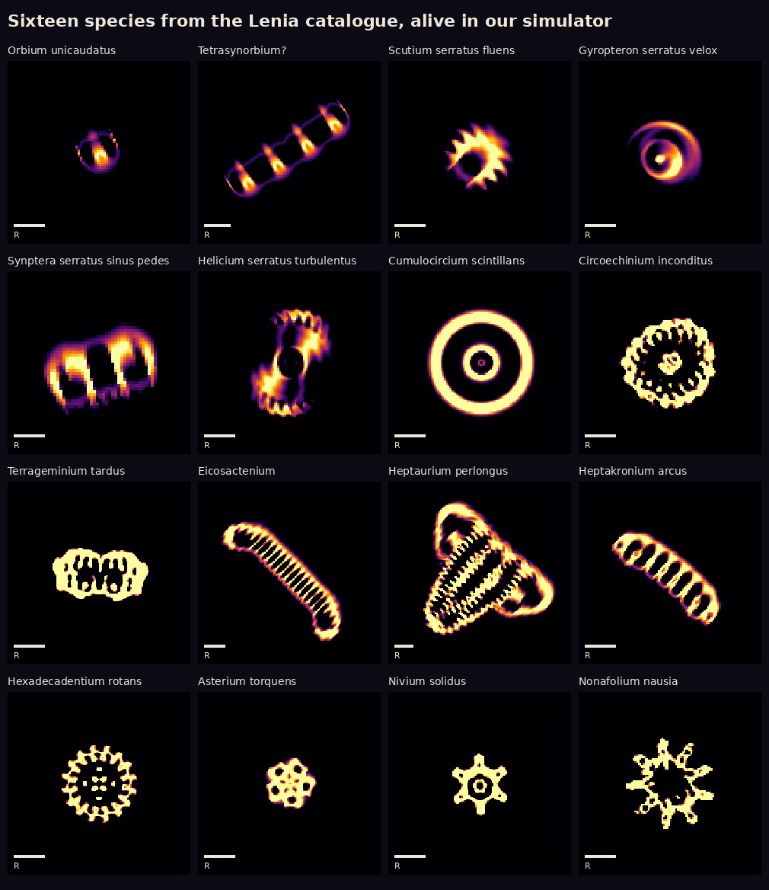
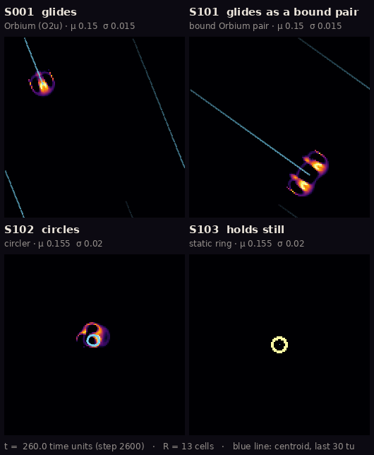
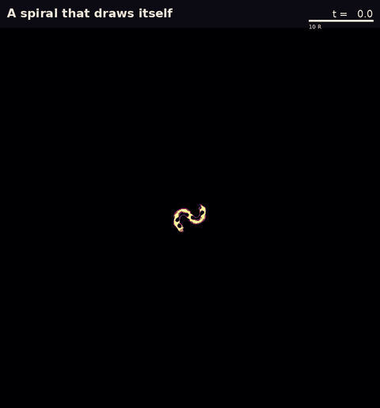
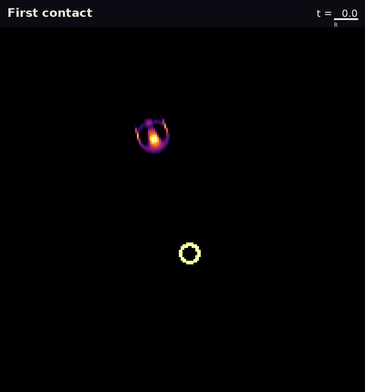
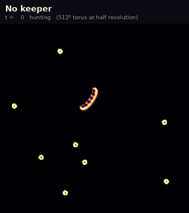
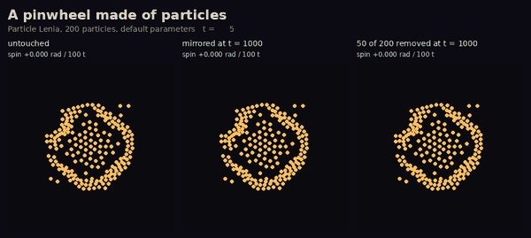
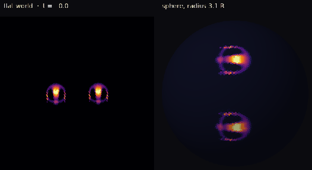
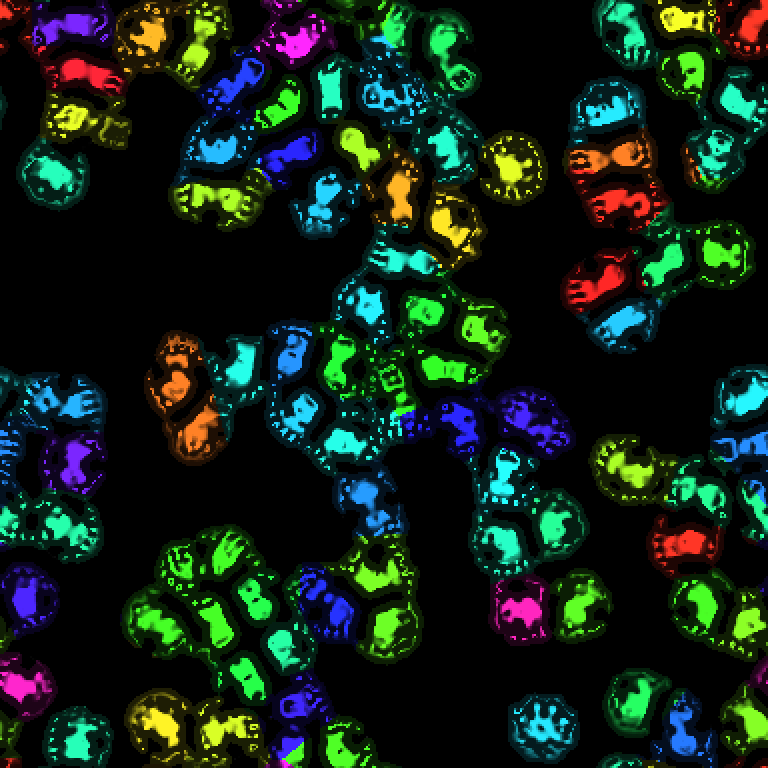
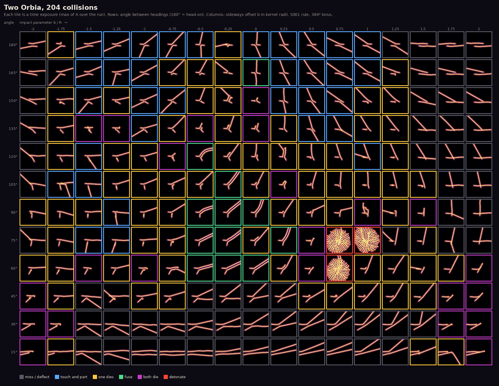
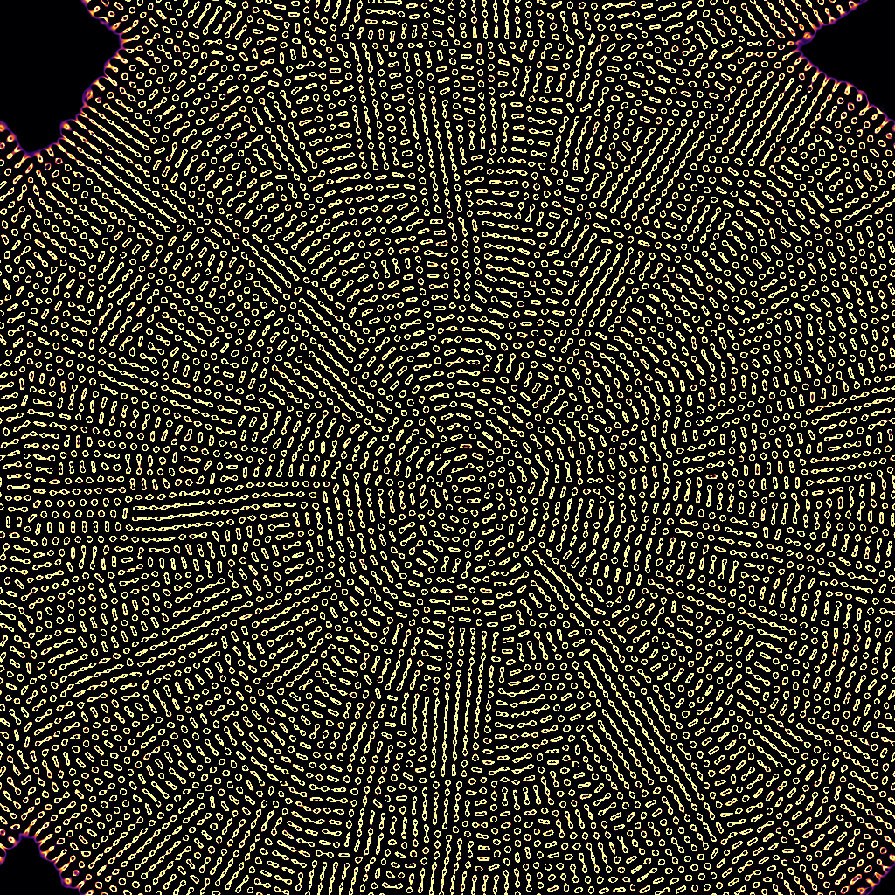

# The Artificial-Life Museum

*The search for Mr Wobbles: a natural history museum of creatures that live inside a simulation.*



These animals live on a grid of numbers. Nobody drew them. Each one is a pattern that keeps its
shape while a single fixed rule rewrites every cell it is made of, ten times per unit of time.
The rule is [Lenia](https://chakazul.github.io/lenia.html), a continuous cousin of Conway's Game
of Life invented by Bert Chan.

This repository is a field station and a museum built on top of it. A team of Claude agents, each
working in its own lane (simulator, replication, disturbance, hostile reviewer, photographer,
exhibition designer and so on), with a human editor deciding what is accepted, ran the
experiments, wrote down every claim with a status, and hung the results in a static museum.
Every picture is a recorded run that can be replayed bit for bit. Every statement links to its
evidence. Some of the best exhibits are ideas that turned out to be wrong.

**Start here:**

- 🏛️ **[Walk the museum](https://bubskee.github.io/artificial-life-museum/museum/site/)**:
  about twenty rooms, from one calibration animal to self-copying cells and evolution.
- 🖼️ **[Browse the gallery](research/gallery/README.md)**: about 60 filmed exhibits (G001–G073),
  each with its provenance and caveats, readable right here on GitHub.
- 📒 **[Read the claims ledger](research/claims.md)**: about 120 claims (C001–C128), each with a
  status, evidence and a reproduction command.

## A few exhibits

<table>
<tr>
<td width="33%"></td>
<td width="33%"></td>
<td width="33%"></td>
</tr>
<tr>
<td><b><a href="research/gallery/README.md#g001--four-ways-to-move">G001 · Four ways to move.</a></b> A glider, a bound pair, a circler and a ring that never changes. The four specimens the museum started with.</td>
<td><b><a href="research/gallery/README.md#g013--a-spiral-that-draws-itself">G013 · A spiral that draws itself.</a></b> A catalogued species (<i>Catenohelicium</i>) winding outward in a 1024² world.</td>
<td><b><a href="research/gallery/README.md#g008--the-reef-one-glider-meets-one-ring">G008 · The reef.</a></b> One glider touches one still ring, and the contact ignites a colony that fills the world.</td>
</tr>
<tr>
<td></td>
<td></td>
<td></td>
</tr>
<tr>
<td><b><a href="research/gallery/README.md#g047--no-keeper">G047 · No keeper.</a></b> A glider loose among still rings eats one with a wing tip, then detonates on the next.</td>
<td><b><a href="research/gallery/README.md#g024--a-pinwheel-made-of-particles">G024 · A pinwheel made of particles.</a></b> Particle Lenia: 200 particles assemble into a spinning ring.</td>
<td><b><a href="research/gallery/README.md#g038--parallel-lines-meet">G038 · Parallel lines meet.</a></b> Two creatures heading the same way stay apart on a flat world but meet on a sphere.</td>
</tr>
<tr>
<td></td>
<td></td>
<td></td>
</tr>
<tr>
<td><b><a href="research/gallery/README.md#g029--a-family-tree">G029 · A family tree.</a></b> One cell divides 135 times over 14 generations; colour shows ancestry.</td>
<td><b><a href="research/gallery/README.md#g035--two-orbia-204-collisions">G035 · Two Orbia, 204 collisions.</a></b> Every way two gliders can meet, as time exposures.</td>
<td><b><a href="research/gallery/README.md#g008--the-reef-one-glider-meets-one-ring">G008 · The reef, at the end.</a></b> The colony from one contact, frozen into a lattice with domains.</td>
</tr>
</table>

The GIFs are previews. Full-quality MP4s sit next to them in each exhibit folder.

## The museum's rooms

The museum is plain HTML and CSS built from the ledger and the gallery
([how it is built](museum/README.md)). Online it is at
**<https://bubskee.github.io/artificial-life-museum/museum/site/>**; to open it from a
clone, see [Run it yourself](#run-it-yourself).

| Wing | Rooms | What you will see |
| --- | --- | --- |
| The first expedition | 1 The ruler: Orbium · 2 The wobble that wasn't · 3 How much can it take? · 4 Three animals, one rule · 5 How we know | The calibration animal measured to the last bit by two independent programs, a "heartbeat" that turned out to be the grid, and how the evidence rules work |
| Open questions | 6 Still being argued · 7 When the glider meets the ring | Work in progress, shown with its caveats, including the reef |
| Field trip | 8 What Lenia can look like | Catalogue species, collisions, soups, spirals, and rules changed under a living creature |
| East wing | 9 More dimensions, more chemicals · 10 Matter that cannot be destroyed · 11 Cousins from other models · 12 Creatures that copy themselves · Evolution in a soup | 3-D Lenia, Flow-Lenia, SmoothLife, Gray-Scott, Particle Lenia, self-replicators and heredity |
| Collision zoo and strange geometries | Collision zoo · Orbium on strange worlds | 204 collisions, gliders that eat rings, Lenia on a sphere, a hyperbolic plane, a cone and a Klein bottle |
| So what? | Evolution, in silicon and in us · How bodies build themselves · Crowds, contagion and machines that invent | What these toys can and cannot tell us about biology, labelled as evidence, tool or analogy |
| Reference | The four specimens · Every claim on display | Dossiers and the full status table |

## How the research works

The project runs on a short [charter](research/charter.md). The unit of progress is not code or a
pretty GIF but a **specimen + reproducible claim + intervention + evidence**.

- **Specimens** have IDs and dossiers in [`research/specimens/`](research/specimens/README.md):
  S001 is the catalogue's Orbium, the calibration animal, and S101–S103 are three animals found
  under the same rule (all three later turned out to be catalogued species too).
- **Claims** live in [`research/claims.md`](research/claims.md). Each has exactly one status:
  `OBSERVED`, `CONJECTURED`, `REPRODUCED`, `INDEPENDENTLY_CHECKED` (two separate implementations
  agree), `NUMERICALLY_FRAGILE` (changes with timestep or resolution) or `REFUTED`. Claims are
  never deleted; a status change is appended to the claim's history.
- **Exhibits** in [`research/gallery/`](research/gallery/README.md) are rendered only after the
  render script replays the run and gets exactly the recorded final state.
- **Experiments** in [`research/experiments/`](research/experiments/) hold the protocols, code and
  outputs behind each claim, and [`research/reports/`](research/reports/) holds the narrative
  write-ups, including a [hostile review](research/reports/hostile-review.md).
- **Mr Wobbles** is a nickname the charter reserves for the first creature that passes six tests,
  including a catalogue check and an independent reproduction. Nobody has earned it yet. Nothing
  here is claimed as a new species.

## Run it yourself

You need Python 3.10 or newer and git.

```bash
git clone https://github.com/bubskee/artificial-life-museum.git
cd artificial-life-museum
./scripts/bootstrap.sh            # makes .venv/, installs the package, fetches the pinned Lenia catalogue
source .venv/bin/activate
```

**Visit the museum offline.** Serve the whole repository (the pages load images from `research/`):

```bash
python3 -m http.server 8000
# open http://localhost:8000/museum/site/
```

**Run a simulation.** Orbium for 2000 steps takes a couple of seconds on a laptop:

```bash
python -m alm.run --specimen S001 --steps 2000
python -m alm.plot research/traces/S001-<run id printed above>
```

Each run writes a folder under `research/traces/` with a provenance manifest, a `trace.csv`, the
saved states, a summary and `final.png`; `alm.plot` adds `overview.png` (mass, speed, path and
final state). Try `--specimen S102` (the circler) or `S103` (the ring), and change the physics
with `--mu`, `--sigma`, `--T`, `--size`, `--kernel {poly,exp}` and `--growth {poly,exp}`.

**Run the tests.** `pytest` checks the simulator, the replays and that every museum badge still
matches the ledger.

<details>
<summary>Extending the simulator</summary>

- Interventions: subclass `alm.interventions.Intervention`, decorate with
  `@alm.interventions.register`, schedule with `--intervene STEP:NAME:k=v,...`.
  The runner re-clips to [0, 1], logs mass before and after and snapshots both sides.
- Measurements: `@alm.measure.register("name")` on a function `(A, sim) -> dict`,
  then `--features basic,name`.
- Python API: `alm.run.run(alm.run.RunConfig(...), out_root=None)` returns the trace rows,
  summary, manifest and final state without writing files.
- Trace format: [`research/traces/README.md`](research/traces/README.md).

</details>

## What is where

| Path | Contents |
| --- | --- |
| [`museum/`](museum/README.md) | Room sources (`rooms/`), the builder and the built site (`site/`) |
| [`research/gallery/`](research/gallery/README.md) | Filmed exhibits G001–G073, each with GIF, MP4 and provenance |
| [`research/claims.md`](research/claims.md) | The claims ledger |
| [`research/charter.md`](research/charter.md) | Mission and rules of evidence |
| [`research/specimens/`](research/specimens/README.md) | Specimen dossiers and seed states |
| [`research/experiments/`](research/experiments/) | One folder per experiment: protocol, code, results |
| [`research/reports/`](research/reports/) | Narrative reports and the hostile review |
| [`research/references.md`](research/references.md) | Literature behind each claim |
| [`research/lenia-research-survey-2026-11.md`](research/lenia-research-survey-2026-11.md) | Who works on Lenia now, and open gaps |
| [`src/alm/`](src/alm/) | ALM's own headless Lenia simulator and instruments |
| [`tests/`](tests/) | pytest suite |

## Credits

Lenia and its species catalogue are the work of Bert Wang-Chak Chan
([Chan 2019, *Lenia: Biology of Artificial Life*](https://arxiv.org/abs/1812.05433);
[Chakazul/Lenia](https://github.com/Chakazul/Lenia), used here as a pinned, unmodified reference
at `adfc542`). Flow-Lenia, Particle Lenia, SmoothLife and the other models in the east wing are
credited in their rooms and in [`research/references.md`](research/references.md).
