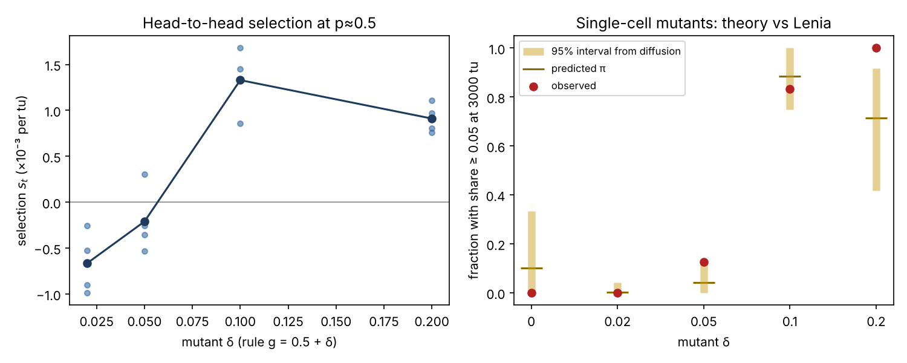

# POPGEN E2: does diffusion theory predict which mutants take hold? (results)

Protocol: [`protocol.md`](protocol.md), committed before any E2 run. Runner `run_e2.py`, data
`e2.jsonl` (88 runs, no duplicates), scores `analyse_e2.py` → `e2_results.json`, figure
`plot_e2.py` → `e2.png`. The δ 0 and δ 0.2 single-cell conditions reuse E1c (s0 and s+), as the
protocol says.

    python analyse_e2.py && python plot_e2.py

## Headline

**With two numbers measured elsewhere, the diffusion approximation predicts single-cell mutant
fate in 4 of 5 conditions, and it misses the fifth on the safe side.** *D* = 61,659 tu comes
only from neutral drift (E1c). Each mutant's selection *s*ₜ comes only from head-to-head runs
started at 50:50 (Phase A). Neither uses the tracker or a generation time. From these, the
model predicts the chance that one mutant cell out of ~74 reaches 5% of the world in 3000 tu,
and Lenia matches it at δ 0, 0.02, 0.05 and 0.1. At δ 0.2 it predicts 72% (interval 5–11 of 12),
and Lenia gives 12 of 12.

**The surprise is the selection curve.** Small increases in the rule parameter are *harmful*.
Mutants at g 0.52 and 0.55 lose head-to-head against residents at g 0.5 (*s*ₜ < 0 in 4/4 and
3/4 runs), and accordingly none of 24 single cells at δ 0.02 took hold. The benefit starts
between δ 0.05 and 0.1. The fitness landscape around g 0.5 has a dip, not a slope.

## Verdicts

| ID | Prediction | Result |
| --- | --- | --- |
| P2a | *s*ₜ increases strictly with δ | **Fail.** Means (×10⁻³/tu): −0.67, −0.21, **+1.33**, +0.91 at δ 0.02, 0.05, 0.1, 0.2. It rises over the first three steps, then drops |
| P2b | all 5 conditions inside the 95% binomial interval of the predicted π | **Partial (4/5).** δ 0: 0/12 (pred 0.10, 0–4). δ 0.02: 0/24 (0.003, 0–1). δ 0.05: 3/24 (0.042, 0–3). δ 0.1: 20/24 (0.885, 18–24). **δ 0.2: 12/12 (0.715, 5–11), outside** |
| P2c | take-hold fraction increases with δ (Spearman ρ > 0) | **Pass**, ρ 0.97 |

**Direction of the P2b miss.** Too many take-holds at δ 0.2. The protocol's reading of that
direction is "drift is weaker for rare types than *D* says". The exploratory check below points
to a different cause, so we do not adopt the protocol's reading.

## Exploratory (not pre-registered): selection depends on frequency at δ 0.2

The *s*ₜ used in the prediction is measured at *p* ≈ 0.5. The same logit-slope fit (t ≥ 100,
0.003 < *p* < 0.9) applied to the single-cell runs themselves gives:

| δ | *s*ₜ at *p* ≈ 0.5 (Phase A) | *s*ₜ from rare start (median of single-cell runs) |
| --- | --- | --- |
| 0.02 | −0.67 | −0.72 (22 runs) |
| 0.05 | −0.21 | −0.24 (24) |
| 0.1 | +1.33 | +1.09 (24) |
| 0.2 | +0.91 | **+1.32** (12, E1c s+) |

(×10⁻³ per tu.) At δ 0.02–0.1 the two agree within run-to-run scatter. At δ 0.2 the rare mutant
is selected about 45% more strongly than at 50:50. With *s*ₜ 1.32 × 10⁻³, the model's π is close
to the δ 0.1 value (~0.9), and 12/12 is no longer surprising (P ≈ 0.25). So the miss looks like
**negative frequency dependence** at large δ (the mutant does best when rare), not extra drift.
The rare-start slopes are conditioned on survival, so this is a lead, not a measurement. A
clean test fits *s*ₜ at fixed starting shares (0.1, 0.5, 0.9) for δ 0.1 and 0.2.

## What this means for the paper

- The spine holds: **two independently measured numbers predict fixation-like outcomes in a
  continuous field with no individuals defined**. That is the claim the paper can lead with,
  pending hostile review.
- Two honest complications become results, not footnotes: the dip in the selection curve
  (small "improvements" are deleterious) and frequency-dependent selection at large δ.
- E3 (fixation proper, longer runs) should use *s*ₜ(*p*) rather than a constant *s*, and should
  include δ 0.02, where theory predicts near-certain loss of a technically "better" rule.

No claims enter `claims.md` until this PR merges and a hostile review has read it.
