# The ALM specimen gallery

Everything in this gallery is a picture of an actual simulation. Nothing is drawn, painted or
generated by hand: each frame is the state of a Lenia world at a recorded step of a recorded run,
and the render script refuses to draw unless its replay of that run ends in exactly the same
state, bit for bit, as the run's manifest says.

**New to Lenia?** Lenia is a grid of cells, each holding a number between 0 (empty, black here)
and 1 (full, pale yellow here). At every step, each cell looks at a ring of neighbours out to a
radius R (13 cells in all of these runs) and grows or shrinks by a fixed rule. That is all. The
"creatures" below are patterns that keep their shape while the rule rewrites every cell they are
made of, ten times per unit of time. Some of them travel; one of them never changes at all.

## Exhibits

| ID | Exhibit | Subjects | Added |
| --- | --- | --- | --- |
| [G001](#g001--four-ways-to-move) | Four ways to move (animated) | S001, S101, S102, S103 | 2026-10-07 |
| [G002](#g002--portraits) | Portraits | S001, S101, S102, S103 | 2026-10-07 |
| [G003](#g003--contact-sheet-half-a-time-unit-at-a-time) | Contact sheet | S001, S101, S102, S103 | 2026-10-07 |
| [G004](#g004--same-cut-two-fates) | Same cut, two fates (before and after) | S101, S001 | 2026-10-07 |
| [G005](#g005--two-steps-apart) | Two steps apart: the circler becomes the ring | S102 → S103 | 2026-10-07 |
| [G006](#g006--the-circler-that-eventually-disappears-provisional) | The circler that eventually disappears (*provisional*) | S102 × 12 starts | 2026-10-08 |
| [G007](#g007--sixteen-catalogued-species) | Sixteen catalogued species (animated) | 16 upstream catalog species | 2026-11-07 |
| [G008](#g008--the-reef-one-glider-meets-one-ring) | The reef: one glider meets one ring, at 1024² (animated) | coexistence glider + S103 | 2026-11-07 |
| [G009](#g009--two-orbia-nine-ways-to-meet) | Two Orbia, nine ways to meet (animated) | S001 × 2 | 2026-11-07 |
| [G010](#g010--same-recipe-three-fates) | Same recipe, three fates: noise under the Orbium rule (animated) | random soups, S001 rule | 2026-11-07 |
| [G011](#g011--anatomy-of-one-step) | Anatomy of one step (animated) | S001 | 2026-11-07 |
| [G012](#g012--catalogued-growers) | Catalogued growers (animated) | 6 upstream catalog species | 2026-11-07 |
| [G013](#g013--a-spiral-that-draws-itself) | A spiral that draws itself (animated) | Catenohelicium monospirae | 2026-11-07 |
| [G014](#g014--a-perfectly-symmetric-world-broken-by-rounding-error) | A perfectly symmetric world, broken by rounding error (animated) | symmetric noise, S001 rule | 2026-11-07 |
| [G015](#g015--a-different-rule-at-every-point) | A different rule at every point (animated; *modified rule*) | noise, μ and σ varying in space | 2026-11-07 |
| [G016](#g016--changing-the-laws-of-physics-under-a-living-creature) | Changing the laws of physics under a living creature (animated; *modified rule*) | S001 Orbium, μ or σ ramped in time | 2026-11-07 |
| [G017](#g017--rush-hour) | Rush hour (animated) | 30 × S001 Orbium | 2026-11-07 |
| [G018](#g018--the-invisible-wall) | The invisible wall (animated; *modified rule*) | S001 Orbium, μ step in space | 2026-11-07 |
| [G019](#g019--rule-90-inside-lenia) | Rule 90 inside Lenia (animated; *discrete limit*) | one cell, 1-D Lenia R 2, T 1 | 2026-11-08 |
| [G020](#g020--rule-90-squared) | Rule 90 squared (animated; *discrete limit*) | one cell, 2-D Lenia R 2, T 1 | 2026-11-08 |
| [G021](#g021--same-body-plan-different-physics) | Same body plan, different physics (animated) | Orbium, crescent, star + 3 catalogue cousins | 2026-11-10 |
| [G022](#g022--matter-that-cannot-be-destroyed) | Matter that cannot be destroyed (animated; *Flow-Lenia*) | FL-43 noise patch, with and without conservation | 2026-11-11 |
| [G023](#g023--spots-that-divide) | Spots that divide (animated; *Gray-Scott*) | one reaction-diffusion spot | 2026-11-11 |
| [G024](#g024--a-pinwheel-made-of-particles) | A pinwheel made of particles (animated; *Particle Lenia*) | 200 particles | 2026-11-11 |
| [G025](#g025--a-smoothlife-glider) | A SmoothLife glider (animated; *SmoothLife*) | SL-32 glider | 2026-11-11 |
| [G026](#g026--lenia-in-three-dimensions) | Lenia in three dimensions (animated; *3-D*) | 4Gu3l, 3Ov1e, 1Sp1v and their slices | 2026-11-11 |
| [G027](#g027--a-three-channel-aquarium) | A three-channel aquarium (animated; *3 channels*) | Chan's found/233 entries 0–11 | 2026-11-11 |
| [G028](#g028--sixty-flow-lenia-worlds) | Sixty Flow-Lenia worlds (still; *Flow-Lenia*) | 60 random rules | 2026-11-11 |
| [G029](#g029--a-family-tree) | A family tree (animated; *multi-kernel*) | one cell of Chan's *division well* (found/213 #84) | 2026-11-14 |
| [G030](#g030--how-fast-one-cell-fills-the-world) | How fast one cell fills the world (animated; *multi-kernel, interpolated rules*) | the same cell under four rules, *well* → *uncontrolled* | 2026-11-14 |
| [G031](#g031--a-replicator-in-three-dimensions) | A replicator in three dimensions (animated; *3-D, multi-kernel*) | Chan's found/312 #21 | 2026-11-14 |
| [G032](#g032--same-world-two-kinds-of-heredity) | Same world, two kinds of heredity (animated; *Flow-Lenia with genomes*) | soup runs B16s0, D16s0 | 2026-11-14 |
| [G033](#g033--where-the-variation-goes) | Where the variation goes (*Flow-Lenia with genomes*) | soup runs B16s0–3, D16s0–3 | 2026-11-14 |
| [G034](#g034--one-physics-many-body-plans) | One physics, many body plans (*Flow-Lenia with genomes*) | eight soup worlds | 2026-11-14 |
| [G035](#g035--two-orbia-204-collisions) | Two Orbia, 204 collisions (still + animated) | S001-rule Orbium × 2 | 2026-11-14 |
| [G036](#g036--the-arc-that-eats-rings) | The arc that eats rings (animated) | P6al fed C0v; P6al–P10al | 2026-11-14 |
| [G037](#g037--tip-or-belly) | Tip or belly (still) | P6al–P10al × C0v | 2026-11-14 |
| [G038](#g038--parallel-lines-meet) | Parallel lines meet (animated; *sphere*) | S001 pairs, eight Orbia, six tiny planets | 2026-11-14 |
| [G039](#g039--parallel-lines-part) | Parallel lines part (animated; *hyperbolic plane*) | S001 pair | 2026-11-14 |
| [G040](#g040--the-lattice-is-the-compass) | The lattice is the compass (chart) | S001, 93 headings on three lattices | 2026-11-14 |
| [G045](#g045--selection-for-faster-division) | Selection for faster division (animated; *modified rule: GenomeLenia*) | one cell with a heritable genome, with and without selection | 2026-11-14 |
| [G046](#g046--the-fast-genome-invades) | The fast genome invades (animated; *modified rule: GenomeLenia*) | *well* tissue against *uncontrolled* tissue | 2026-11-14 |
| [G047](#g047--no-keeper) | No keeper (animated) | P6al loose among 8 × C0v | 2026-11-14 |
| [G048](#g048--two-orbia-fuse-into-s101) | Two Orbia fuse into S101 (still) | fused bodies of G035, S101 | 2026-11-14 |
| [G049](#g049--a-lens-made-of-nothing) | A lens made of nothing (animated; *cone points*) | S001 pairs past a 300°, 360° and 420° point | 2026-11-14 |
| [G050](#g050--straight-at-the-point) | Straight at the point (animated; *cone points*) | S001 aimed at each point | 2026-11-14 |
| [G051](#g051--fit-or-lucky) | Fit, or lucky? (*Flow-Lenia with genomes*) | 12 mutant genomes × 6 replays | 2026-11-14 |
| [G052](#g052--one-genome-seven-landings) | One genome, seven landings (animated; *Flow-Lenia with genomes*) | mutants 8 and 4 | 2026-11-14 |
| [G053](#g053--through-the-looking-glass) | Through the looking glass (animated; *Klein bottle*) | S001 | 2026-11-14 |
| [G054](#g054--the-mirror-next-door) | The mirror next door (animated; *Klein bottle*) | S001 on a narrow torus and Klein bottle | 2026-11-14 |
| [G060](#g060--from-well-behaved-to-runaway) | From well-behaved to runaway (animated; *modified rule: GenomeLenia*) | one cell at genome 0.1, 512², 6000 tu | 2026-11-14 |
| [G061](#g061--how-far-selection-goes) | How far selection goes (chart; *modified rule: GenomeLenia*) | every evolution run, selected vs neutral | 2026-11-14 |

### G001 — Four ways to move

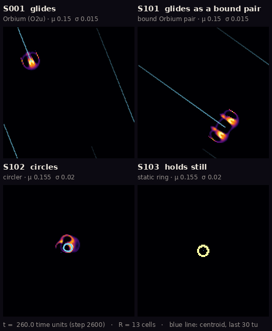

Full-quality video: [`four-ways.mp4`](exhibits/G001-four-ways-to-move/four-ways.mp4) ·
provenance: [`provenance.json`](exhibits/G001-four-ways-to-move/provenance.json)

Four worlds, one clock: the last 40 time units of each run (steps 2600–3000), played at 4 time
units per second. Each panel is a whole 128 × 128 world. The worlds wrap around, so a creature
leaving one edge comes back on the opposite edge. The blue line traces each creature's centre of
mass over the last 30 time units.

- **Observation.** S001 crosses its world in straight lines. S101 does the same with twice the
  body. S102 moves about as fast as S001 but along a circle only a few cells across, so it goes
  nowhere. S103 does not change at all.
- **Interpretation.** The ledger, not this picture, says what is established. S001's straight
  heading is held by the grid at R = 13 rather than chosen freely ([C011, C013](../claims.md)). S102
  and S103 live under a slightly different rule from S001 (μ 0.155, σ 0.020 instead of 0.15,
  0.015), at which Orbium also persists ([C038](../claims.md), Lane 6, not yet reproduced by a second
  lane).

### G002 — Portraits

| | |
| --- | --- |
| 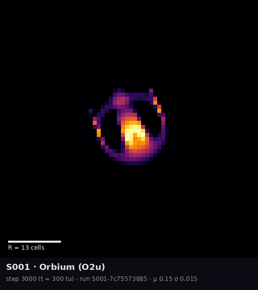 | 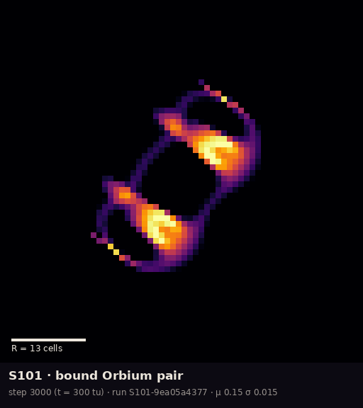 |
| 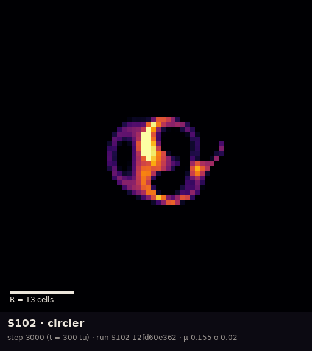 | 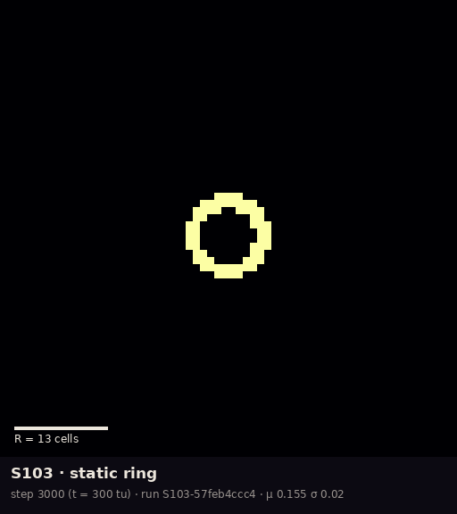 |

Each portrait is a 64 × 64-cell window at step 3000, shifted by whole cells so the creature's
centre sits in the middle. Each square block of pixels is one cell. The white bar is one kernel
radius R = 13 cells. Provenance: [`provenance.json`](exhibits/G002-portraits/provenance.json).

- **S001, Orbium (O2u).** It has a bright crescent core, a dimmer shell and a thin outer arc.
- **S101, bound Orbium pair.** Two Orbium bodies side by side, joined by one shared thin shell.
  Its mass is 2.004 × Orbium's, and it travels 1.4% slower ([C041](../claims.md), from Lane 6's dossier).
- **S102, circler.** Its shape is never the same twice (see G003).
- **S103, static ring.** It is a ring of fully saturated cells, and nothing in it moves. The
  ring is exactly the same at step 0 and at step 3000: the run's initial and final state hashes
  are equal (`a81efdac…`), as Lane 6 reported ([C042](../claims.md)).

### G003 — Contact sheet: half a time unit at a time

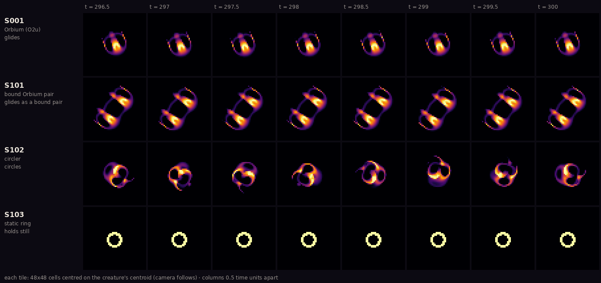

Eight frames per creature, 5 steps (0.5 time units) apart, ending at step 3000. Here the camera
follows each creature, so travel is hidden and only changes of shape remain. G001 shows the
travel. Provenance: [`provenance.json`](exhibits/G003-contact-sheet/provenance.json).

- **Observation.** S001 and S101 look almost the same in every frame. S102 looks different in
  every frame. S103 looks identical in every frame.
- **Not a claim.** Eight frames do not establish a period. S102's turning rate (about 95° per
  time unit, one lap per ~3.8 time units) comes from Lane 6's dossier, not from this sheet.

### G004 — Same cut, two fates

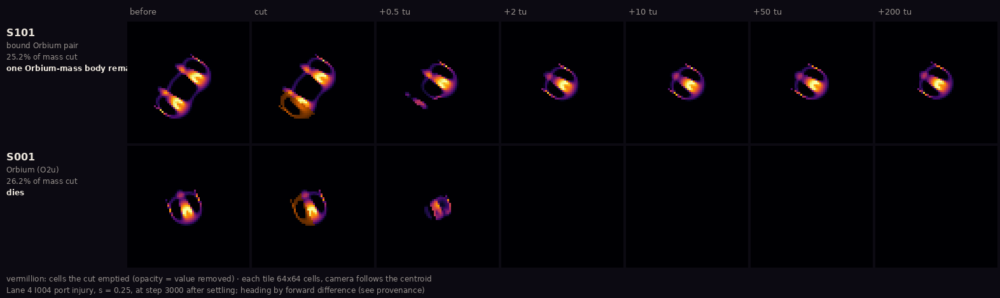

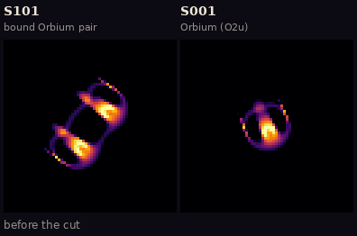

Video: [`port-injury.mp4`](exhibits/G004-port-injury/port-injury.mp4) · provenance:
[`provenance.json`](exhibits/G004-port-injury/provenance.json)

Both creatures settle for 300 time units. Then each gets the same injury: Lane 4's I004 "port
injury" removes about a quarter of the mass, taken from the left-hand side relative to the
direction of travel (s = 0.25). In the "cut" column, the vermillion cells are what was removed.
After that the world runs on with no further help. The camera follows each creature. The film
covers 2 time units before the cut to 60 after it and holds on the cut frame for one second.

- **Observation.** In the pair, the cut takes most of one partner. What is left of that partner
  is a small fragment at half a time unit and is gone by 2 time units. The other partner
  glides on, and from then on it looks like an ordinary single Orbium. Its mass at the end of
  the run, 200 time units later, is 0.437 (a single Orbium's is 0.4358). The single Orbium
  loses the same share of itself and is gone (zero mass) 13 steps after the cut.
- **Interpretation, from the ledger.** This matches Lane 6's C041 (*observed*, not yet reproduced
  by a second lane). There, 18 of 18 pair runs at injuries of 10–50% ended as one Orbium, and every
  single-Orbium control died at 10% or more. Lane 6's own caveat applies here too: the cut lands
  mostly on one partner because they sit side by side. So the pair is not healing. The coupling
  just does not drag the uninjured partner down.
- **Disclosed difference.** Lane 4 takes the direction of travel from the previous step. The
  gallery's wrapper ([`galintervene.py`](galintervene.py)) takes it from one probe step forward,
  because the runner's intervention hook does not see the previous state. The cut itself is Lane
  4's `i004_port_injury` unchanged.

### G005 — Two steps apart

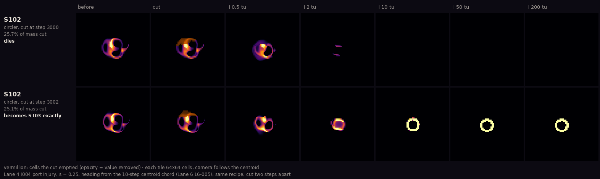

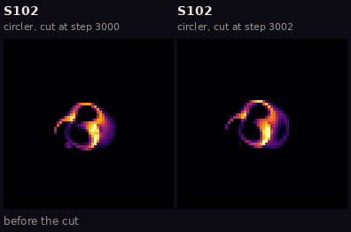

Video: [`circler-ring.mp4`](exhibits/G005-circler-to-ring/circler-ring.mp4) · provenance:
[`provenance.json`](exhibits/G005-circler-to-ring/provenance.json)

Two copies of the circler S102 get the same injury: Lane 4's I004 port injury at s = 0.25. The
only difference is timing. One is cut at step 3000, the other two steps later at step 3002. The
cut follows Lane 6's own recipe from L6-005. "Port" is taken from the direction the circler moved
over the previous 10 steps. A circler turns fast, so that direction differs by about 15° between
the two cuts. Both films are aligned on their own cut.

- **Observation.** Cut at step 3000, the circler falls apart and is gone 25 steps later. Cut at
  step 3002, it shrinks into a small bright ring within about 10 time units. From 46 time units
  after the cut, it stops changing at all. Its final state is S103 exactly: cell for cell the
  same values, shifted on the grid (checked by `equals_up_to_shift` in `render.py`).
- **Interpretation, from the ledger.** This is Lane 6's C040 (*observed*, not yet reproduced by a
  second lane). There, a port injury turned the circler into S103 in 2 of 38 I004 runs, both in
  this phase. The gallery's run repeats Lane 6's numbers exactly through `alm.run`. That stepper is
  bitwise equal to Lane 6's (C038), so this is a rerun, not an independent check. Two runs
  cannot show how often the switch happens or why one phase and not the other.
- **Why it is here.** One exhibit has the gallery's three behaviours in a single lineage: a
  circler, a death, and a still ring. It also shows how much the outcome depends on two steps
  of timing.

### G006 — The circler that eventually disappears (*provisional*)

> **Provisional.** The evidence it quotes from Lane 3's
> [L3-003](../experiments/L3-003-circler-lifetime/README.md) (PR #29) and Lane 7's
> [HR-009](../reports/hostile-review.md) (PR #30) and Lane 6's
> [L6-007](../experiments/L6-007-attractor-geography/README.md) follow-up (PR #27, merge 7cbf5ae)
> are all merged on main, and they draw the same line as this caption (divergence at every setting,
> collapse seen only at R 13, T 10, step 39 799 one trajectory). The ledger holds no claim on
> S102's lifetime yet. The
> pictures are verified replays; the reading of them below is not settled.
>
> **Shown at R 13, T 10 only; not seen under refinement.** Lane 3's L3-003 (merged)
> reproduces Lane 6's R 13, T 10 deaths in an independent engine, but sees none when the grid is
> finer (0 of 29 runs at R 26, to 5000–8000 tu; 0 of 3 at R 39, 8000 tu) or the timestep smaller
> (0 of 24 at T 20 and 0 of 24 at T 40, R 13, 8000 tu each). So the disappearance below is
> specific to the R 13, T 10 discretization, the grid and the step together, not a property the
> creature has been shown to keep in finer simulations. Whether S102 lasts forever there is not
> established either: every refined run was simply still alive when it stopped.

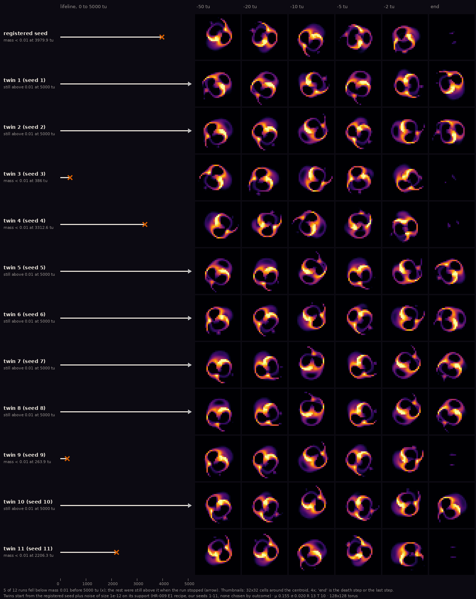

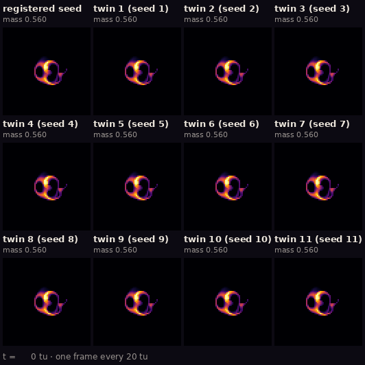

Video (one frame every 10 tu): [`eventually-gone.mp4`](exhibits/G006-eventually-gone/eventually-gone.mp4) ·
provenance: [`provenance.json`](exhibits/G006-eventually-gone/provenance.json)

Twelve runs of the circler S102 at its registered rule, each for 5000 time units (50 000 steps).
One starts from the registered seed. The other eleven are twins: the same seed plus noise of size
10⁻¹² on the cells it covers, which is Lane 7's HR-009 recipe drawn with our own random seeds
1–11. None was chosen by outcome. A run counts as gone when its total mass falls below 0.01
(in units of R²), the threshold Lane 6 and Lane 7 use.

- **Observation.** Five of the twelve are gone before 5000 tu, at 264, 386, 2206, 3313 and
  3980 tu. The other seven are still circling when the run stops, with mass 0.51–0.54. In the
  sheet's last-moments columns, each of the five still looks like a whole circler 2 tu before it
  is gone, so the collapse takes under 2 tu. We could not see any sign in the film of which runs
  would go. The registered seed is gone at step 39 799 (3979.9 tu), the same step as in Lane 6's
  L6-007 follow-up.
- **Interpretation, provisional.** Two things are going on, and the refinement results separate
  them. *Divergence:* twins that start 10⁻¹² apart separate about e-fold every 5 tu at R 13, T 10
  (HR-009 E1), so the step at which one run dies belongs to that floating-point trajectory, not to
  the rule. *Collapse:* at R 13, T 10 some of those trajectories fall apart; Lane 7 pools 37 runs
  (20 deaths, earliest at 292 tu, censored mean about 5900 tu, more early deaths than an
  exponential predicts). Under refinement the divergence persists but weakens (HR-009b: half the
  rate at T 20, about 13 times slower at R 26), while the collapse was not observed at all within
  L3-003's horizons. So the collapse needs something the R 13, T 10 discretization adds; HR-009b
  names lattice-driven mass fluctuation as a candidate, untested. None of this shows the circler
  lasts forever on a finer grid, only that no run there ended before it was stopped. Our twelve
  are a picture of the spread, not a lifetime estimate; seven of them say only "still alive at
  5000 tu". The matching step 39 799 is not an independent check: HR-009 attributes that
  agreement to engines that perform the same FFT operations, while L3-003 reproduces Lane 6's
  R 13 deaths in an independent engine. Lane 9's Figure D
  (`research/figures/D-pair-and-circler/`, PR #33, provisional) pools 37 starts into a survival
  curve. When the ledger records a claim, this caption will cite it and drop the provisional
  label.
- **Why it is here.** One canonical death time would be the wrong picture. Twelve near-identical
  starts show what the evidence so far supports at this resolution: the circler can last
  thousands of time units and then fall apart abruptly, and when it goes is not predictable from
  how it looks. On a finer grid or with a smaller step, L3-003 has not seen it fall apart at all.

### G007 — Sixteen catalogued species

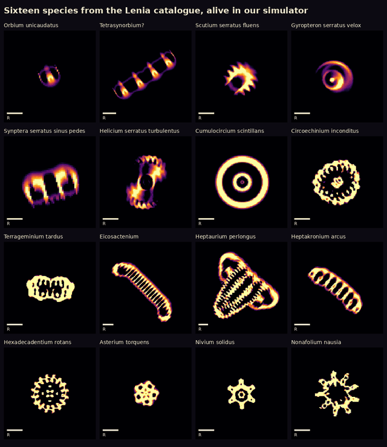

Full-quality video: [`bestiary.mp4`](exhibits/G007-bestiary/bestiary.mp4) · still:
[`bestiary-still.png`](exhibits/G007-bestiary/bestiary-still.png) · provenance:
[`provenance.json`](exhibits/G007-bestiary/provenance.json)

Sixteen species from Bert Chan's catalogue (`Chakazul/Lenia@adfc542`, `Python/animals.json`),
each under its own catalogued rule and in its own periodic world, filmed from 60 to 90 time units
after the catalogue's seed. Each tile follows its creature; tiles have different cell scales,
so each carries its own R bar.

- **Observation.** All sixteen are still bounded, non-empty patterns after 90 time units in
  ALM's simulator. They glide, rotate (Gyropteron, Helicium, Hexadecadentium), pulse
  (Cumulocircium) or crawl as long chains (Eicosactenium, Heptakronium).
- **Not a claim about the catalogue.** The tiles were picked by eye for variety from the VIS-S1
  survey ([`SURVEY.md`](../experiments/VIS-talk/SURVEY.md), claim C057), which only checks that a
  bounded pattern persists for 100 tu, not that it is the catalogued shape. Every name and seed is
  Chan's; nothing here is a new species.

### G008 — The reef: one glider meets one ring

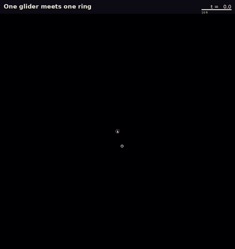

Full-quality video (use this on a projector): [`reef-world.mp4`](exhibits/G008-the-reef/reef-world.mp4) ·
close-up of first contact: [`reef-contact.mp4`](exhibits/G008-the-reef/reef-contact.mp4)
([GIF](exhibits/G008-the-reef/reef-contact.gif)) · stills:
[`reef-world-t60.png`](exhibits/G008-the-reef/reef-world-t60.png),
[`reef-world-final.png`](exhibits/G008-the-reef/reef-world-final.png),
[`reef-lattice-detail.png`](exhibits/G008-the-reef/reef-lattice-detail.png) · mass:
[`mass.csv`](exhibits/G008-the-reef/mass.csv) · provenance:
[`provenance.json`](exhibits/G008-the-reef/provenance.json)

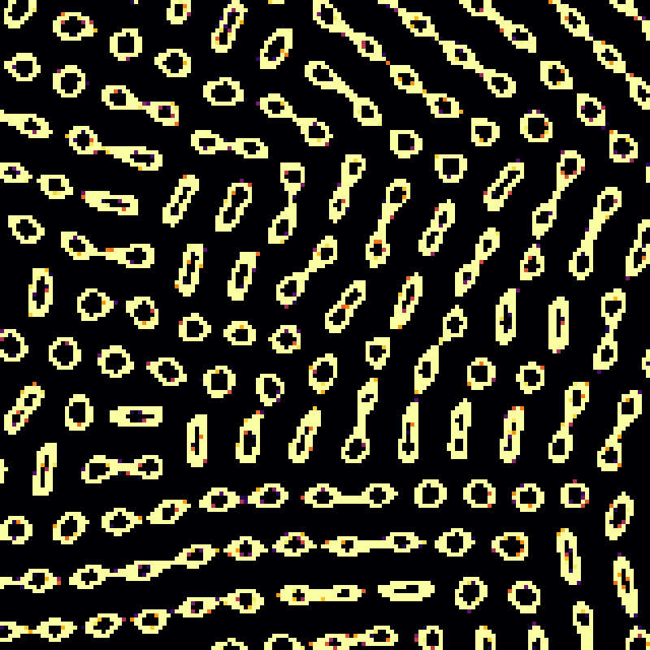

The REEF expedition's head-on encounter P2 (the settled coexistence glider aimed at S103), rebuilt
with the expedition's own `REEF-field/runner.build` but in a 1024² world, 16 times the area of
the expedition's main runs. 130 time units.

- **Observation.** Contact, fusion and ignition happen as in the expedition (C052). The front
  then keeps going until the colony covers the whole world at about 130 tu (mass 29 at 25 tu,
  285 at 60 tu, 1274 at 130 tu, in units of R²). Behind the front the lattice of small rings and
  dumbbells is frozen, and it forms domains of aligned bodies with visible boundaries between them.
- **What the ledger says.** C052 is checked only for 3–25 tu at N256/N512. Everything here after
  25 tu, and the 1024² world itself, is one `alm` run with no second arithmetic route. Ignition
  timing and colony mass are numerically fragile in T and R (C053). The domains are an
  observation in one run, not a measured property.
- **Not novel.** Chan 2019 §3.5.5 lists "detonation" among collision outcomes; see the
  expedition report's literature section.

### G009 — Two Orbia, nine ways to meet

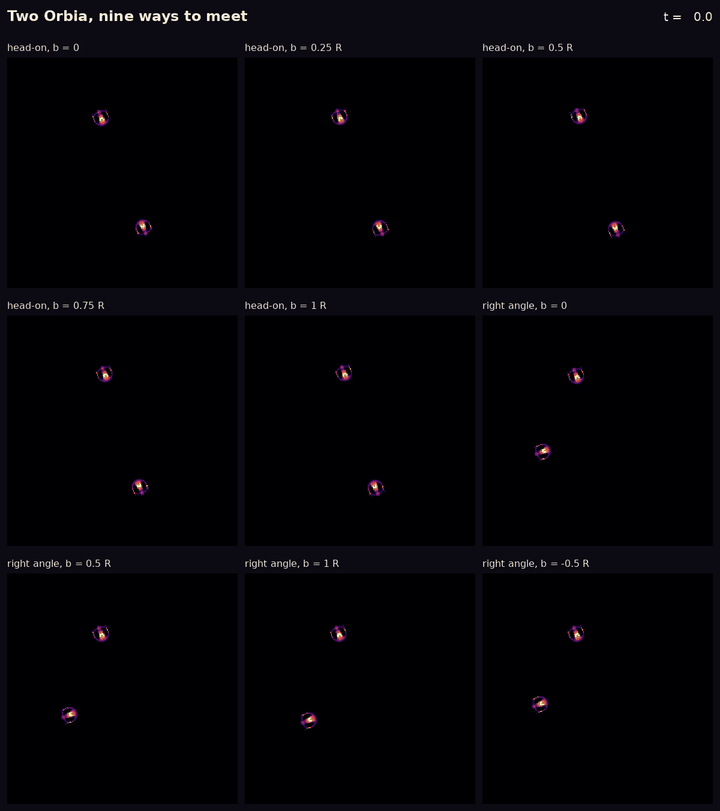

Full-quality video: [`collisions.mp4`](exhibits/G009-orbium-collisions/collisions.mp4) ·
outcomes at 120 tu: [`collisions-outcomes.png`](exhibits/G009-orbium-collisions/collisions-outcomes.png),
[`outcomes.json`](exhibits/G009-orbium-collisions/outcomes.json) · provenance:
[`provenance.json`](exhibits/G009-orbium-collisions/provenance.json)

Two copies of the settled S001 Orbium. The second is the first rotated by 180° (head-on, five
transverse offsets b) or by 90° (right angle, four offsets); rotations by multiples of 90° are
exact symmetries of the square-grid kernel. Each start is 5 R from the meeting point; 120 tu on
256².

- **Observation (claim C058).** Head-on: b = 0, 0.75 R and 1 R scatter with both surviving;
  b = 0.25 R annihilates both; b = 0.5 R fuses them into one bound pair. Right angle: b = 0 fuses
  them into one bound pair; b = 0.5, 1 and −0.5 R leave one survivor.
- **Interpretation.** One phase and one starting distance per geometry, so each panel is one
  sample. Chan 2019 §3.5.5 (pdf pp. 28–29) already names these outcomes (deflection, absorption,
  annihilation, fusion); this is our simulator reproducing that zoo, not a new result. Whether the
  fused pairs are S101 (C041) has not been checked.

### G010 — Same recipe, three fates

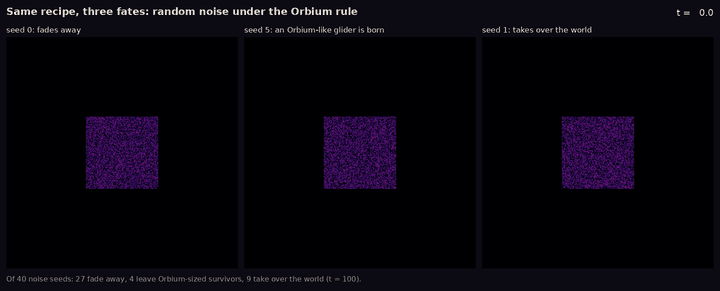

Full-quality video: [`soup.mp4`](exhibits/G010-soup/soup.mp4) · scan of all 40 seeds:
[`soup-scan.json`](exhibits/G010-soup/soup-scan.json) · provenance:
[`provenance.json`](exhibits/G010-soup/provenance.json)

An 80 × 80 square of uniform random values in [0, 0.3), centred on an empty 256² world, under
the S001 Orbium rule; 40 seeds to 100 tu. The film shows the first seed of each outcome in seed
order, not the prettiest.

- **Observation (claim C056).** 27 of 40 fade away; 4 leave a survivor with one Orbium's mass
  (in seed 5 it is visibly an Orbium-like glider); 9 fill the world with a frozen lattice of small
  bodies.
- **Interpretation.** Orbium emerging from a "primordial soup" is how Chan found it (2019 §2.3.1,
  pdf p. 12). The world-filling lattice under the S001 rule looks like the reef (G008) but comes
  from a different rule; we have not compared them. Most other amplitudes we tried in a six-seed
  pilot died out entirely.

### G011 — Anatomy of one step

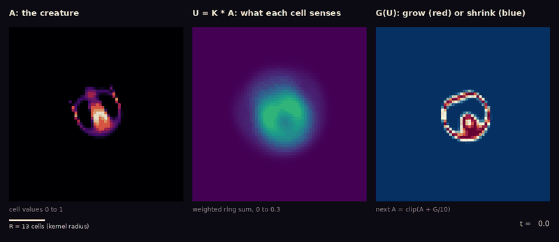

Full-quality video: [`anatomy.mp4`](exhibits/G011-anatomy-of-a-step/anatomy.mp4) · kernel:
[`kernel.png`](exhibits/G011-anatomy-of-a-step/kernel.png) · provenance:
[`provenance.json`](exhibits/G011-anatomy-of-a-step/provenance.json)

A teaching exhibit: the S001 Orbium with the three quantities of every Lenia step side by side.
A is the state; U = K * A is the neighbourhood sum through the ring kernel; G(U) is the growth
(red grows, blue shrinks), and the next state is clip(A + G/10). U is shown in `viridis` clipped
to 0–0.3 and G in `RdBu_r` from −1 to 1, both disclosed in the provenance. No claim.

### G012 — Catalogued growers

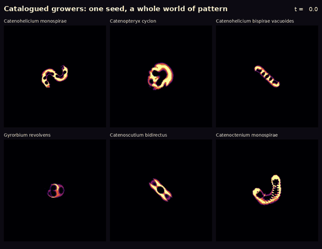

Full-quality video: [`growers.mp4`](exhibits/G012-growers/growers.mp4) · final frames:
[`growers-final.png`](exhibits/G012-growers/growers-final.png) · provenance:
[`provenance.json`](exhibits/G012-growers/provenance.json)

Six catalogue species that grow without bound, from their seeds to 100 tu, each in its own world
(256² or 512²). This exhibit is downsampled (Lanczos) and is not one pixel per cell.

- **Observation.** The spiral grows until it meets its own periodic image, where a labyrinth
  takes over; two species fill their worlds with labyrinths; Gyrorbium revolvens fills its world
  with a lattice of rings; Catenoscutium grows one straight chain across the torus.
- **Interpretation.** Growth is these species' catalogued behaviour ("Cateno-" means chain-forming;
  Chan 2019 §3.5.4 describes elongation, including spiral elongation in Helicidae). The labyrinths
  resemble reaction–diffusion patterns; that is a resemblance, not a tested mechanism.

### G013 — A spiral that draws itself

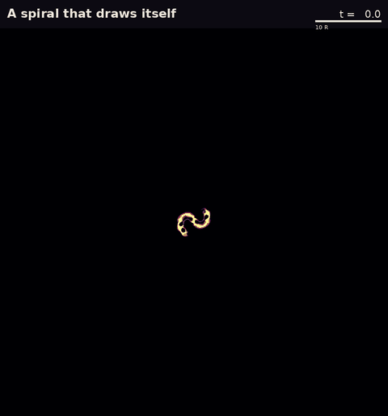

Full-quality video: [`spiral.mp4`](exhibits/G013-spiral/spiral.mp4) · still:
[`spiral-final.png`](exhibits/G013-spiral/spiral-final.png) · mass:
[`mass.csv`](exhibits/G013-spiral/mass.csv) · provenance:
[`provenance.json`](exhibits/G013-spiral/provenance.json)

Catenohelicium monospirae (catalogue `HN+m`) from its seed to 150 tu in a 1024² world, showing
the central 768² cells at one pixel per cell. Catalogued behaviour (Chan 2019 §3.5.4), shown at a
world size where the arm can wind several times before it meets its own periodic image.

## Round two: stranger worlds (G014–G018)

Three of these five (G015, G016, G018) are **not classic Lenia**: μ or σ varies in space or in
time. They run on `FieldLenia` in `research/experiments/VIS-talk/ex_bizarre.py`. It repeats
`alm.lenia.Lenia`'s step operation for operation, and with uniform S001 parameters it equals
`Lenia` bit for bit over 200 steps. Each provenance file records that this check passed at render
time. G014 and G017 are plain `Lenia` runs.

### G014 — A perfectly symmetric world, broken by rounding error

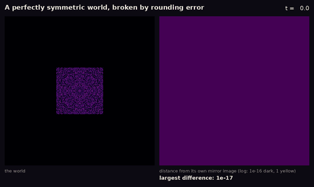

Video: [`kaleidoscope.mp4`](exhibits/G014-kaleidoscope/kaleidoscope.mp4) · stills at 10, 30 and 50 tu ·
[`asymmetry.csv`](exhibits/G014-kaleidoscope/asymmetry.csv) ·
[`provenance.json`](exhibits/G014-kaleidoscope/provenance.json)

An 80 × 80 noise patch with all eight symmetries of the square, run under the S001 rule. In exact
arithmetic the world would stay symmetric forever.

- **Observation (claim C059).** The largest difference between the world and its mirror image
  is 0 at the start, 2 × 10⁻¹³ at 5 tu, 3 × 10⁻¹⁰ at 15 tu, 2 × 10⁻⁵ at 25 tu and 1 by 40 tu,
  while the colony is growing. Before that point the four-fold symmetric "mandala" stage is
  exactly visible.
- **Interpretation.** FFT rounding seeds the asymmetry, and the growing front amplifies it. A
  different FFT library would break the symmetry differently.

### G015 — A different rule at every point

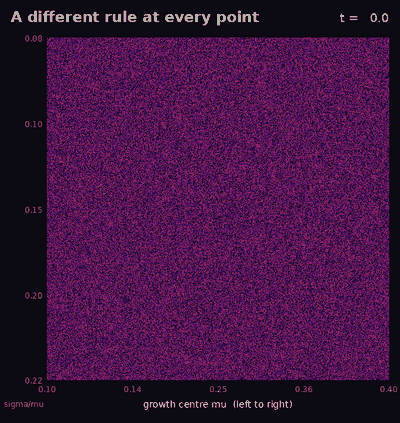

Video: [`map-of-worlds.mp4`](exhibits/G015-map-of-worlds/map-of-worlds.mp4) · final:
[`map-of-worlds-final.png`](exhibits/G015-map-of-worlds/map-of-worlds-final.png) ·
[`provenance.json`](exhibits/G015-map-of-worlds/provenance.json)

A 1024² world of random noise. μ runs from 0.10 to 0.40 across it and σ/μ from 0.08 to 0.22 down
it. Both vary along a cosine, so the torus has no seam. The film shows the 512² quadrant where both
rise. After 200 tu the world sorts itself into spots, then labyrinths, then stripes, with an empty
region at high μ and narrow σ.

This is a picture, not a phase diagram. A pattern feels parameters up to R = 13 cells away, and
the regime boundaries are shaped by the gradient itself. It shows one seed at one horizon.

### G016 — Changing the laws of physics under a living creature

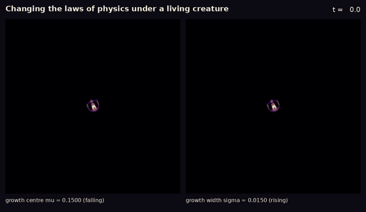

Video: [`live-mutation.mp4`](exhibits/G016-live-mutation/live-mutation.mp4) · mass series ·
[`provenance.json`](exhibits/G016-live-mutation/provenance.json)

The S001 Orbium, with μ lowered from 0.15 to 0.11 (left) or σ raised from 0.015 to 0.035 (right),
linearly over 150 tu. The Orbium follows each change for a long time. In both runs it eventually
bursts into a world-filling lattice, and on the left it first passes through a two-lobed body.
Changing parameters gradually is Chan's own way of morphing species (2019 §2.3.2). The creature is
never at equilibrium with the rule.

### G017 — Rush hour

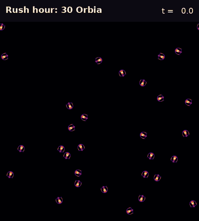

Video: [`rush-hour.mp4`](exhibits/G017-rush-hour/rush-hour.mp4) ·
[`rush-hour-t30.png`](exhibits/G017-rush-hour/rush-hour-t30.png) ·
[`mass.csv`](exhibits/G017-rush-hour/mass.csv) ·
[`provenance.json`](exhibits/G017-rush-hour/provenance.json)

Thirty copies of the S001 Orbium, rotated and mirrored at random, in one 512² world under the
plain S001 rule. Within a few time units one collision detonates (Chan 2019 §3.5.5). The colony
grows from 13 to 54 R² by 30 tu and fills the world (327 R²) by about 90 tu, swallowing every
glider it meets. This is one random arrangement.

### G018 — The invisible wall

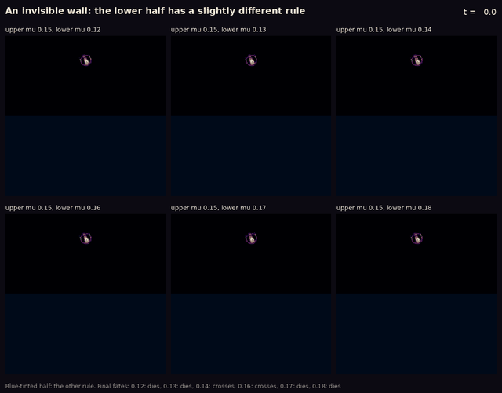

Video: [`invisible-wall.mp4`](exhibits/G018-invisible-wall/invisible-wall.mp4) ·
[`provenance.json`](exhibits/G018-invisible-wall/provenance.json)

- **Observation (claim C060).** The S001 Orbium glides from rows with μ 0.15 into rows with
  μ = 0.12, 0.13, 0.14, 0.16, 0.17 or 0.18. It crosses and keeps going for 0.14 and 0.16, and it
  dies at the wall for the other four.
- **Caveats.** The step in μ is sharp, so the Orbium feels the wall up to 13 cells before it
  arrives. Each lane uses one phase and one approach angle. A "cross" means a body with Orbium's
  mass persisted, not that its shape is unchanged.

### G019 — Rule 90 inside Lenia

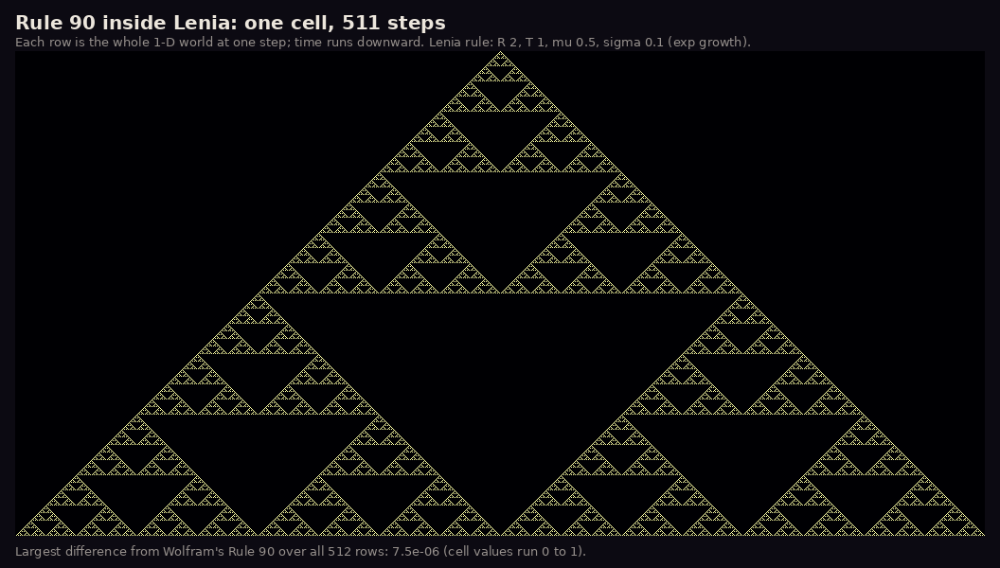

Films: [`rule90-grows.mp4`](exhibits/G019-rule-90-inside-lenia/rule90-grows.mp4) (the triangle drawing
itself) · [`melt-sweep.mp4`](exhibits/G019-rule-90-inside-lenia/melt-sweep.mp4) (σ 0.10 → 0.30 and
back) · still: [`melt-grid.png`](exhibits/G019-rule-90-inside-lenia/melt-grid.png) ·
[`provenance.json`](exhibits/G019-rule-90-inside-lenia/provenance.json)

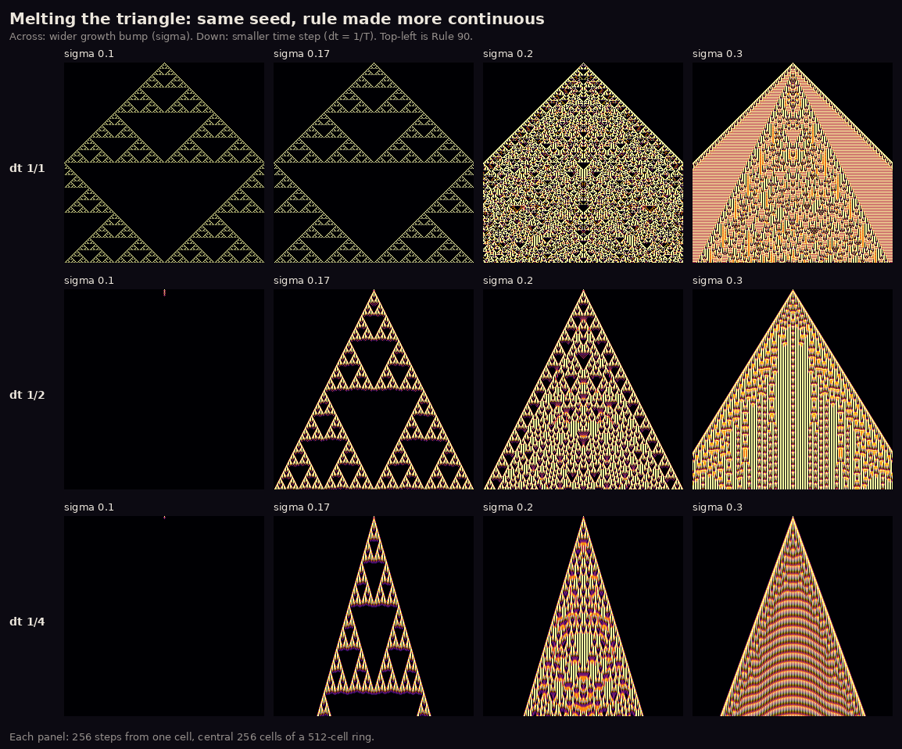

- **Observation (claim C061).** Shrink Lenia to one row, a kernel of radius 2 and a time step of 1, and
  a single cell grows Wolfram's Rule 90, the Sierpinski triangle, to within 7.5 × 10⁻⁶. Widen the
  growth bump or shrink the time step and the triangle first survives with blurred edges
  (dt = 1/2, 1/4 at σ 0.17), then dissolves into a disordered cone.
- **Interpretation.** This is the 1-D version of Chan's observation that Game of Life is a corner of
  Lenia (Chan 2019 §2.1.6). Only seven elementary rules sit exactly in this corner, and Rule 90 is
  the only chaotic one. Rule 30 and Rule 110 cannot appear, because Lenia's kernel is mirror-symmetric.
- **Caveats.** T = 1 is far from where Lenia's creatures live (T = 10). The melt grid is descriptive.

### G020 — Rule 90 squared

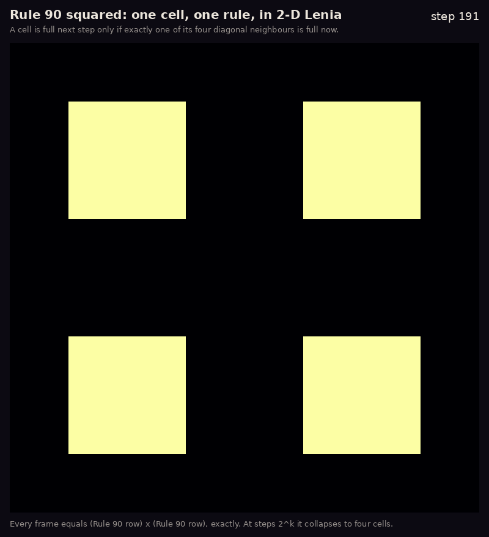

Film: [`rule90-squared.mp4`](exhibits/G020-rule-90-squared/rule90-squared.mp4) · time exposure:
[`rule90-squared-exposure.png`](exhibits/G020-rule-90-squared/rule90-squared-exposure.png) ·
[`provenance.json`](exhibits/G020-rule-90-squared/provenance.json)

- **Observation (claim C062).** In 2-D, with the growth centred on the weight of exactly one diagonal
  neighbour, one cell grows a pattern that is, at every step and with zero error, Rule 90 times
  Rule 90: fractal dust that fills a square at steps 2^k − 1 and collapses to four cells at 2^k.
  The time exposure shows the fractal carpet left behind.
- **Rendering.** Live cells sit on a checkerboard, so each pixel block shows a 2 × 2 block of cells
  (max for frames, sum for the exposure).

## Species hunt (G021)

### G021 — Same body plan, different physics

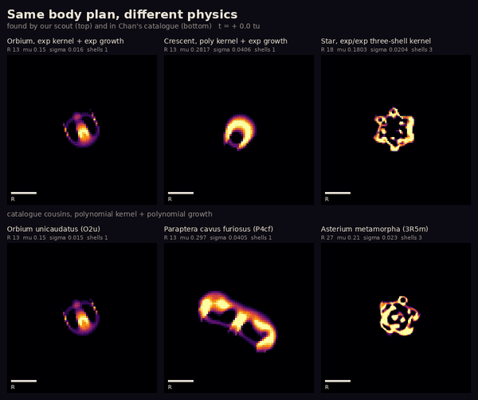

Video: [`convergence.mp4`](exhibits/G021-convergence/convergence.mp4) ·
[`convergence-still.png`](exhibits/G021-convergence/convergence-still.png) ·
[`provenance.json`](exhibits/G021-convergence/provenance.json)

- **Observation (claim C063).** The species hunt (`research/experiments/SPECIES-scout/SCOUT.md`) looked in
  kernel/growth families that the catalogue barely uses. Everything it found already had a catalogued body plan.
  Moved into all four poly/exp kernel × growth combinations, the four test bodies keep their motion class.
  Top: ours. Bottom: the nearest catalogue entry under its own poly/poly rule.
- **Caveats.** Nothing here is a new species. The crescent is a single hollow segment, and its cousin P4cf has two.
  The star runs at R 18 and Asterium at R 27, so their fine texture differs. Each top-row body is one seeded soup.


## Other worlds (G022–G028)

Worlds beyond classic 2-D Lenia, each with its own simulator in `research/experiments/WINGS/`
(notes: [`WINGS.md`](../experiments/WINGS/WINGS.md)). Films: `film_wings.py G0xx`, checked by
`film_wings.py verify`. Single-channel worlds use inferno; the three-channel aquarium maps
channels to red, green and blue; particles are drawn as discs.

### G022 — Matter that cannot be destroyed

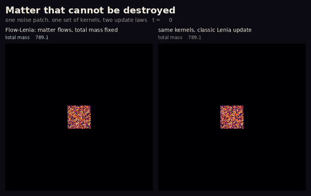

Film: [`conservation.mp4`](exhibits/G022-conservation-makes-individuals/conservation.mp4) ·
[`provenance.json`](exhibits/G022-conservation-makes-individuals/provenance.json)

- **Observation (claims C064, C065).** Under Flow-Lenia rule FL-43 a 40 × 40 noise patch splits
  into separate ring cells with total mass fixed to 10⁻¹². The same kernels with the classic
  update grow the patch 21-fold into a maze.
- **Interpretation.** Conservation turns a growth rule into a sharing rule: each cell can only
  take matter from its neighbours, so bodies have a size, and more matter makes more bodies.
- **Caveats.** One rule out of sixty (G028). Our Flow-Lenia is written from the paper.

### G023 — Spots that divide

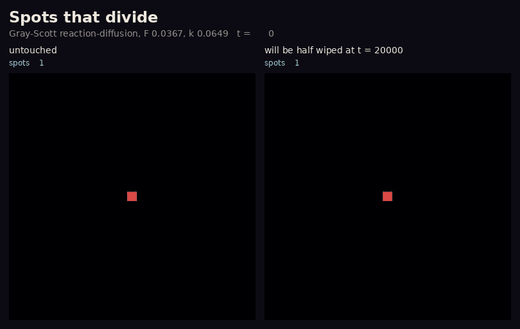

Film: [`spots.mp4`](exhibits/G023-spots-that-divide/spots.mp4) ·
[`provenance.json`](exhibits/G023-spots-that-divide/provenance.json)

- **Observation (claim C066).** One spot becomes about 300. After the left half is wiped at
  t = 20000, the spots on the border divide back into it and reach the control count by 40000.
- **Caveats.** Pearson's (1993) regime; v in [0, 0.45] on inferno.

### G024 — A pinwheel made of particles

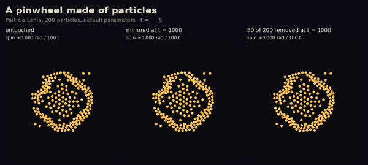

Film: [`pinwheel.mp4`](exhibits/G024-particle-pinwheel/pinwheel.mp4) ·
[`provenance.json`](exhibits/G024-particle-pinwheel/provenance.json)

- **Observation (claim C067).** 200 particles assemble into a spiky ring that spins at about
  0.2 rad per 100 time units. Mirrored, it spins the other way; with 50 particles removed it
  slows.
- **Caveats.** The direction of spin depends on the seed and even on the timestep.

### G025 — A SmoothLife glider

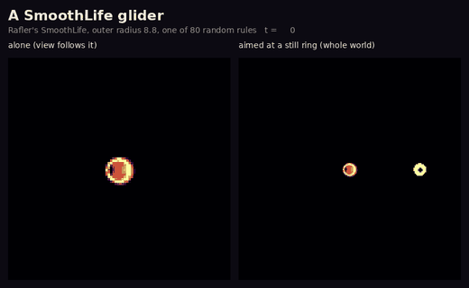

Film: [`glider.mp4`](exhibits/G025-smoothlife-glider/glider.mp4) ·
[`provenance.json`](exhibits/G025-smoothlife-glider/provenance.json)

- **Observation (claim C068).** The glider from SmoothLife rule SL-32 slides for 1000 time
  units. Aimed at a still ring, it merges with it and leaves on a new heading.
- **Caveats.** Its speed is not converged in resolution (+46 % per outer radius at ×2).

### G026 — Lenia in three dimensions

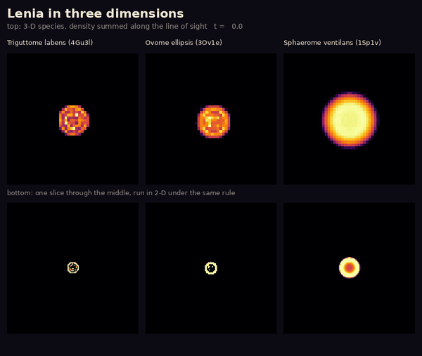

Film: [`three-d.mp4`](exhibits/G026-three-dimensions/three-d.mp4) ·
[`provenance.json`](exhibits/G026-three-dimensions/provenance.json)

- **Observation (claims C069, C070).** Chan's Triguttome labens glides in 3-D; Ovome ellipsis
  and Sphaerome ventilans hold still. Their middle slices, run in 2-D under the same rule, boil
  into dust, settle into a ring, and fade, respectively.
- **Rendering.** Top: density summed along the line of sight in a 48³ box following the body, scaled per species.

### G027 — A three-channel aquarium

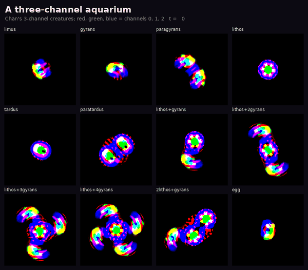

Film: [`aquarium.mp4`](exhibits/G027-three-channel-aquarium/aquarium.mp4) ·
[`provenance.json`](exhibits/G027-three-channel-aquarium/provenance.json)

- **Observation (claims C069, C071).** Chan's twelve three-channel creatures under their own
  15-kernel rule. Zeroing any one channel kills every one of them.
- **Caveats.** Creatures, names and rule are Chan's (found/233.json); the engine is ours.

### G028 — Sixty Flow-Lenia worlds

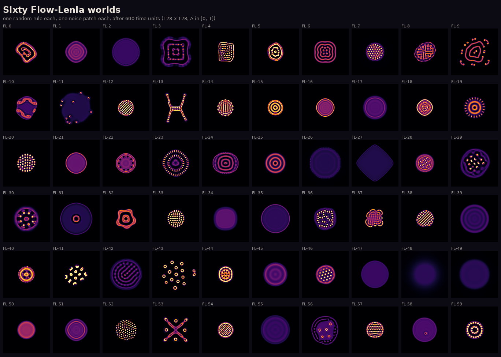

[`provenance.json`](exhibits/G028-sixty-flow-worlds/provenance.json)

- **Observation (scout for C064).** Sixty random rules, one noise patch each, after 600 time
  units. Most make one body (droplet, ringed membrane, crystal inside a membrane, wheel); a few
  make colonies (FL-9, FL-11, FL-41, FL-43, FL-53).

## Replicators (G029–G031)

Creatures from Chan's multi-kernel "found" catalogue that make copies of themselves, run in our
N-D engine (`research/experiments/WINGS/nd_lenia.py`). Notes and scripts:
[`REPLICATORS.md`](../experiments/REPLICATORS/REPLICATORS.md). The creatures and their names
are Chan's; the tracking, the rule line and the films are ours.

### G029 — A family tree

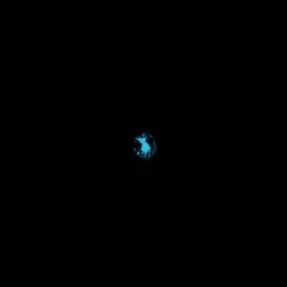

Film: [`family-tree.mp4`](exhibits/G029-family-tree/family-tree.mp4) ·
tree: [`tree.png`](exhibits/G029-family-tree/tree.png) ·
[`provenance.json`](exhibits/G029-family-tree/provenance.json)

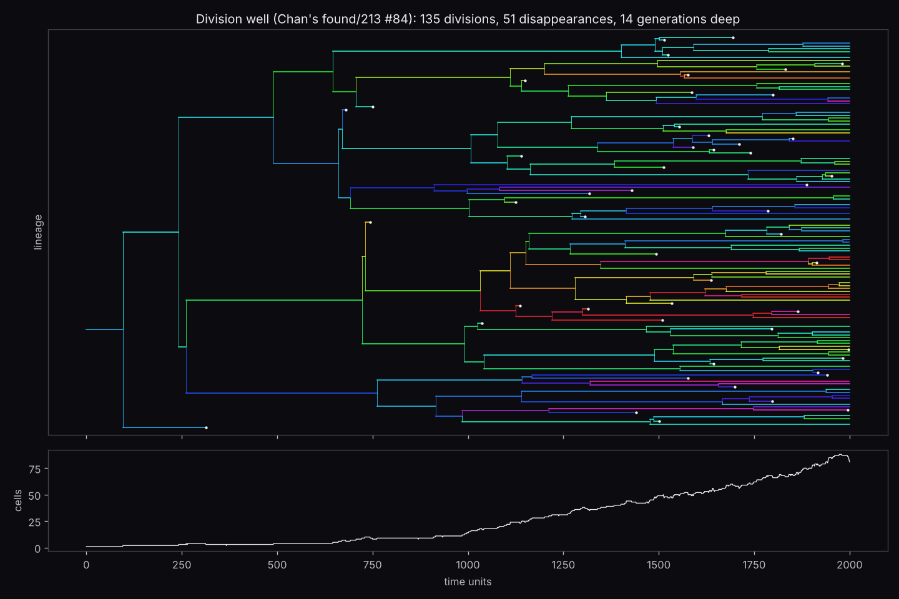

- **Observation (claim C072).** One cell of *division well* on a 384² torus becomes 81 cells in
  2000 time units, through 135 divisions, 14 generations deep.
- **Rendering.** Every pixel of a cell takes the hue of the nearest tracked cell centre. Hue is
  a neutral marker: a daughter's hue is her mother's plus a small random step (fixed seed), so
  families share colours. Brightness is the field value.
- **Caveats.** A "cell" is a peak of the field blurred by 4 pixels. Births that last under 10
  time units, and peaks that merely jump, are dropped (`tree.py`). The tracker cannot tell a
  merger from a cell that fades.

### G030 — How fast one cell fills the world

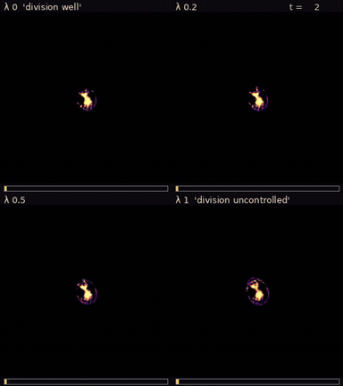

Film: [`ladder.mp4`](exhibits/G030-four-growth-rates/ladder.mp4) ·
[`provenance.json`](exhibits/G030-four-growth-rates/provenance.json)

- **Observation (claim C073).** Every rule number moved a fraction λ of the way from Chan's
  *division well* to his *division uncontrolled*. Time to cover half the world: about 1300
  time units at λ 0, 90 at λ 1. Bars show the covered fraction.
- **Caveats.** The intermediate rules (λ 0.2, 0.5) are ours, not catalogue entries.

### G031 — A replicator in three dimensions

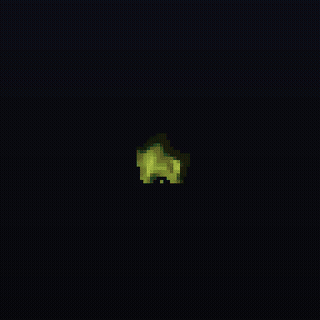

Film: [`replicator3d.mp4`](exhibits/G031-replicating-in-3d/replicator3d.mp4) ·
[`provenance.json`](exhibits/G031-replicating-in-3d/provenance.json)

- **Observation (claim C074).** Chan's *self-replicate... unstable* (found/312 #21) in a 96³
  periodic box: one body, then 4 by t 100, then about 50 by t 300, until the box is full.
- **Rendering.** The box turns slowly about the vertical axis. Each pixel shows the first voxel
  above 0.25 along the line of sight, lit from the upper left; each separate body has its own
  hue. Because the box is periodic, bodies leaving one side reappear on the other.

## Evolution soup (G032–G034, G051–G052)

Flow-Lenia worlds in which every cell carries a genome (ten growth weights) that travels with
its matter and now and then mutates; matter is conserved, so bodies compete for it. Engine and
notes: [`SOUP.md`](../experiments/SOUP/SOUP.md). Colour is the genome (a fixed random projection
of the ten weights to RGB), brightness is the matter.

### G032 — Same world, two kinds of heredity

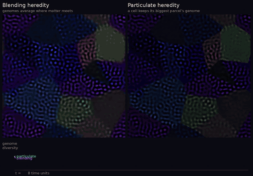

Film: [`duel.mp4`](exhibits/G032-two-heredities/duel.mp4) ·
final frame: [`duel-final.png`](exhibits/G032-two-heredities/duel-final.png) ·
[`provenance.json`](exhibits/G032-two-heredities/provenance.json)

- **Observation (claims C077, C076).** Kernel set 16, seed 0, 2400 time units, from the identical
  start. Left, genomes average where matter meets: a slime grows into a giant that engulfs the
  dot-shaped plankton. Right, a cell keeps the genome of the biggest parcel that arrives: the
  plankton survive and the blobs become genome mosaics.
- **Caveats.** One seed is shown; the ledger numbers cover four.

### G033 — Where the variation goes

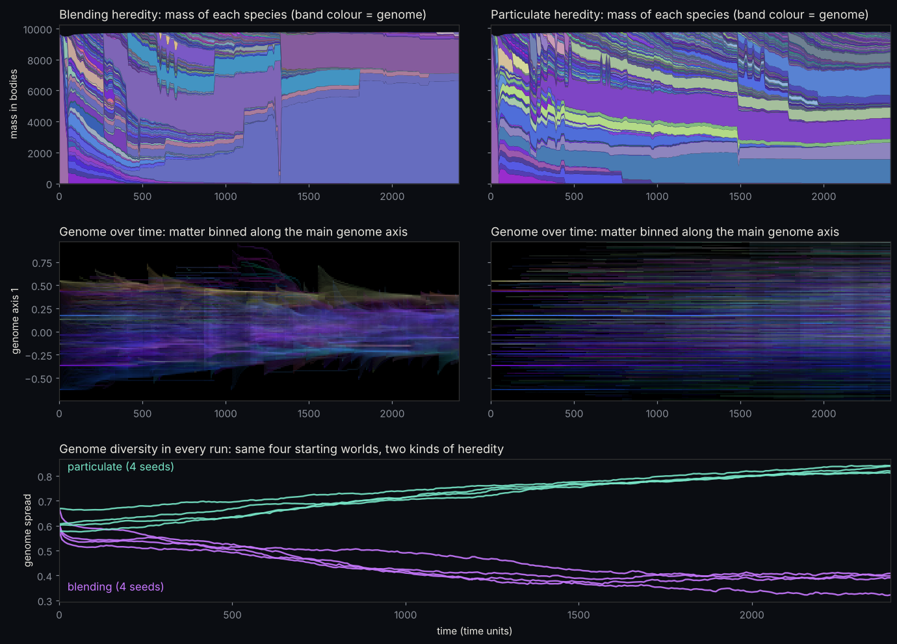

[`provenance.json`](exhibits/G033-blending-swamps-variation/provenance.json)

- **Observation (claim C076).** Top: mass per species (bodies with similar genomes; a drawing
  convention). Middle: all matter binned along the main genome axis; under blending each mutation
  leaves a wedge that tapers back into the mean. Bottom: genome spread in all eight runs.

### G034 — One physics, many body plans

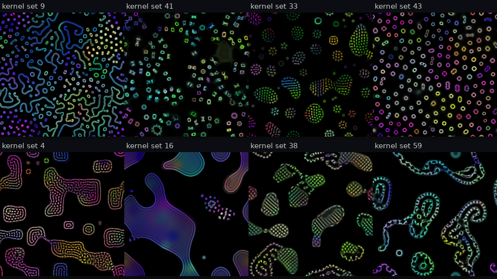

[`provenance.json`](exhibits/G034-one-physics-many-bodies/provenance.json)

- **Observation (no claim).** Eight worlds, one kernel set each, 16 founder genomes each. Inside
  one world the founders build different bodies from the same kernels. Most worlds settle into a
  still mosaic; kernel set 16 did not.

### G051 — Fit, or lucky?

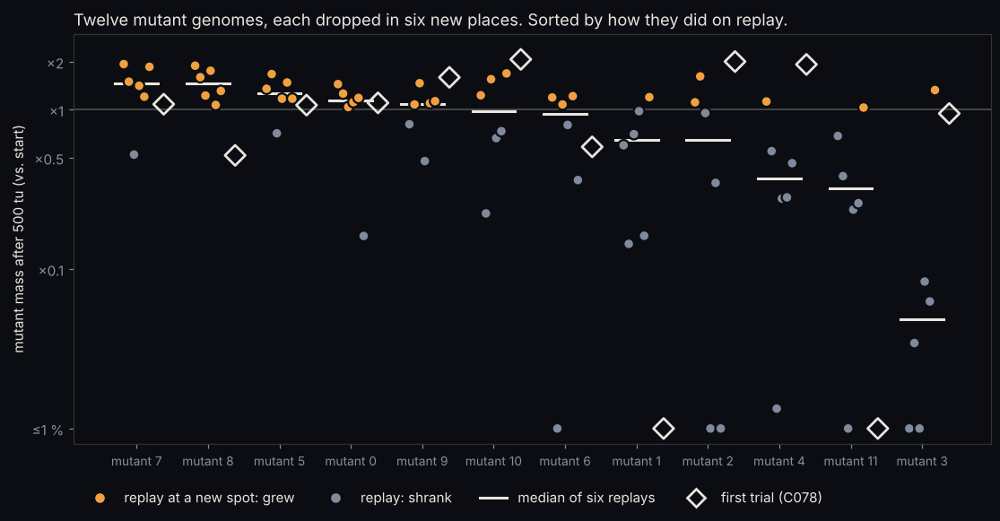

[`provenance.json`](exhibits/G051-fit-or-lucky/provenance.json)

- **Observation (claims C099, C100, C101).** Each column is one of the twelve C078 mutant genomes
  dropped into the same one-species world at six new places, under whole-genome inheritance.
  Dots: how much matter the mutant holds after 500 time units, relative to its start. Diamond:
  the genome's first trial. The columns are sorted by replay median; the diamonds do not follow.

### G052 — One genome, seven landings

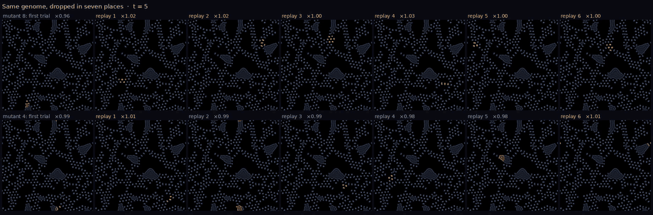

Film: [`landings.mp4`](exhibits/G052-seven-landings/landings.mp4) ·
final frame: [`landings-final.png`](exhibits/G052-seven-landings/landings-final.png) ·
[`provenance.json`](exhibits/G052-seven-landings/provenance.json)

- **Observation (claims C099, C100).** Top row: mutant 8, which shrank in its first trial (left)
  and grew in all six replays. Bottom row: mutant 4, which nearly doubled in its first trial and
  shrank in five of six replays. Orange = matter carrying the mutant genome; blue-grey = the
  resident species. The replays were re-made for the film and match their recorded final hashes; the two first
  trials are re-created from the stored (rounded) mutation and track the record within 0.06.

## Collision zoo (G035–G037, G047–G048)

### G035 — Two Orbia, 204 collisions

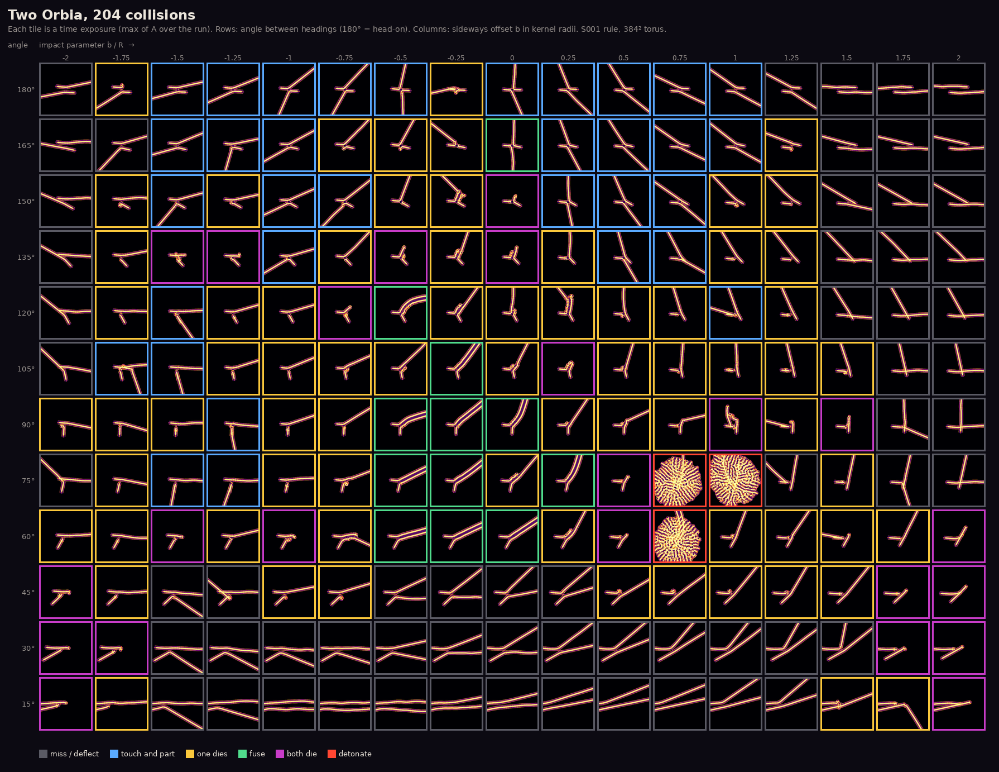

Film: [`detonation.mp4`](exhibits/G035-orbium-collision-atlas/detonation.mp4) ·
[`detonation.gif`](exhibits/G035-orbium-collision-atlas/detonation.gif) ·
[`provenance.json`](exhibits/G035-orbium-collision-atlas/provenance.json)

- **Observation (claim C080).** Every tile is one collision of two S001-rule Orbia, drawn as a
  time exposure (the brightest value each cell ever reached), so tracks show as trails. Rows are
  the angle between the two headings (180° = head-on), columns the sideways offset. The border
  colour is the outcome: glance off, touch and part, one dies, fuse, both die, detonate. The film
  is the 75° detonation: two gliders touch and a labyrinth fills the world. G009 showed nine of
  these meetings; this is the whole grid.
- **Caveats.** Time exposures use A^0.7 to show faint trails (disclosed). The map is one
  discretisation: at half the timestep the same six outcomes appear, but only 54 % of tiles keep
  their outcome (C080).

### G036 — The arc that eats rings

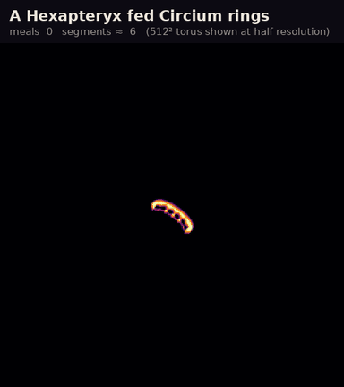

Film: [`feeding.mp4`](exhibits/G036-the-arc-that-eats-rings/feeding.mp4) ·
still: [`ladder.png`](exhibits/G036-the-arc-that-eats-rings/ladder.png) ·
[`provenance.json`](exhibits/G036-the-arc-that-eats-rings/provenance.json)

- **Observation (claims C082, C083).** A catalogue Hexapteryx (P6al) is offered one Circium ring
  (C0v) at a time, at its wing tip. Each ring it swallows adds one segment. `ladder.png` puts the
  fed arc after 0–4 meals under the catalogue's P6al–P10al: same shape, same mass. The film runs
  25 meals, to about 31 segments.
- **Caveats.** A keeper places every ring by hand and rewinds meals that did not grow the arc
  (each try is logged in `feed-altfilm.json`). The film shows the 512² torus at half resolution.

### G037 — Tip or belly

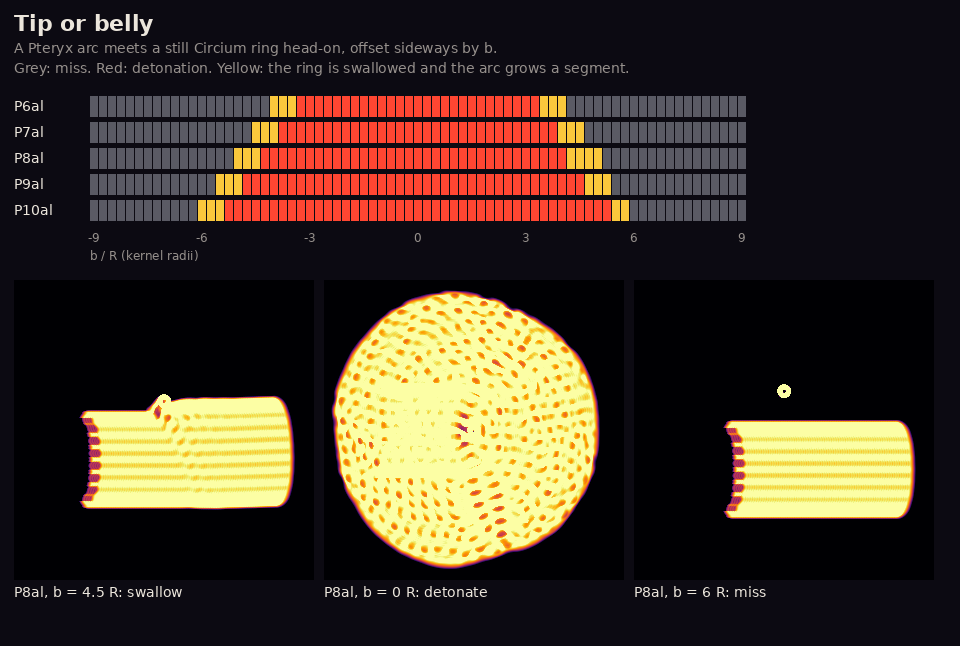

[`provenance.json`](exhibits/G037-tip-or-belly/provenance.json)

- **Observation (claim C081).** Each Pteryx arc (P6al–P10al) is aimed head-on at a still ring,
  offset sideways in quarter-radius steps. A ring that meets the body detonates the arc; one that
  meets a wing tip is swallowed; further out it is missed. The swallow window moves out by half
  a radius per segment, with the tip.
- **Caveats.** One timestep and one world size. Exposures use A^0.7 (disclosed).

### G047 — No keeper

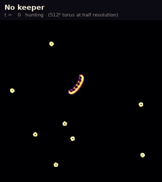

Film: [`no-keeper.mp4`](exhibits/G047-no-keeper/no-keeper.mp4) ·
[`provenance.json`](exhibits/G047-no-keeper/provenance.json)

- **Observation (claim C093).** A Hexapteryx loose among eight still rings, nobody placing
  anything. At t 110 it meets a ring with a wing tip and swallows it (now seven segments); at
  t 205 it meets the next ring with its body and detonates. This is one of the 6 lucky runs out
  of 64; the other 58 detonated on their first ring.
- **Caveats.** The 512² torus is shown at half resolution.

### G048 — Two Orbia fuse into S101

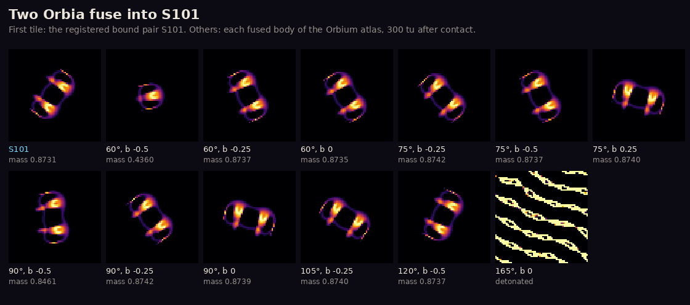

[`provenance.json`](exhibits/G048-fusion-makes-s101/provenance.json)

- **Observation (claim C094).** First tile: S101, the registered bound Orbium pair. The others:
  every collision of G035 that fused, 300 tu after contact. Nine have S101's mass, size and
  speed. One shed a lobe and is a single Orbium again; one detonated late.
- **Caveats.** Tiles are 61×61 cells, nearest-neighbour; bodies are at whatever heading they
  locked to.

## Strange geometries (G038–G040, G049–G050, G053–G054)

Made by `research/experiments/GEOM/film.py` and `compass.py` (strange-geometries thread). The
worlds are point clouds, not square grids, so each pixel shows its *nearest cell* (the cell
mosaic shows when zoomed in); A maps linearly onto `inferno` as everywhere else. Globes add a
disclosed Lambert shading (0.5 + 0.5 cos) and a faint blue lift on empty cells so the ball is
visible. `film.py verify` replays every run and compares final hashes.

### G038 — Parallel lines meet


Film: [`meet.mp4`](exhibits/G038-parallel-lines-meet/meet.mp4) ·
[`meet-strip.png`](exhibits/G038-parallel-lines-meet/meet-strip.png) ·
planet: [`planet.mp4`](exhibits/G038-parallel-lines-meet/planet.mp4),
[`planet-still.png`](exhibits/G038-parallel-lines-meet/planet-still.png) ·
[`tiny-planets.png`](exhibits/G038-parallel-lines-meet/tiny-planets.png) ·
[`provenance.json`](exhibits/G038-parallel-lines-meet/provenance.json)

- **Observation.** Two Orbia 3 R apart and heading the same way: on the flat torus they keep
  their distance; on a sphere of radius 40 cells they lean together, touch within 7 tu and go on
  as one joined body. Eight Orbia on a sphere of radius 60 collide until two remain (80 tu).
  On planets of radius 25 down to 7 cells one Orbium wraps into a band and keeps gliding; at 6
  and 5 cells only slow patches remain.
- **Ledger.** C084 (pairs on spheres: 14 of 16 meet, outcomes), C085 (they follow great
  circles), C086 (tiny planets); all *observed*.
- **Caveats.** Icosahedral geodesic grid (12 five-fold defects), area-weighted kernel. The fused
  body is matched to S101 by mass and size only.

### G039 — Parallel lines part


Film: [`part.mp4`](exhibits/G039-parallel-lines-part/part.mp4) ·
[`part-still.png`](exhibits/G039-parallel-lines-part/part-still.png) ·
[`provenance.json`](exhibits/G039-parallel-lines-part/provenance.json)

- **Observation.** The same pair on the hyperbolic plane (curvature radius 2 R), drawn as a
  Poincaré disk: they spread apart along circular arcs, the geodesics of the disk picture, and
  look smaller near the rim because the picture shrinks distances there.
- **Ledger.** C085 (separation follows the geodesic law within 0.27 R), *observed*.
- **Caveats.** The world is a disk of radius 4 κ (104 cells), empty beyond; the animals leave
  it after about 25 tu. {3,7} geodesic grid with exact cell areas.

### G049 — A lens made of nothing


Film: [`lens.mp4`](exhibits/G049-a-lens-made-of-nothing/lens.mp4) ·
[`lens-final.png`](exhibits/G049-a-lens-made-of-nothing/lens-final.png) ·
[`provenance.json`](exhibits/G049-a-lens-made-of-nothing/provenance.json)

- **Observation.** Pairs 4 R apart pass a single conical point: 300° (60° cut out) bends them
  together until they meet; flat keeps them parallel; 420° (60° added) bends them apart.
- **Ledger.** C096, C097, *observed*.
- **Caveats.** Disks are drawn opened out (angle × 360/Θ), so straight paths look bent at the
  apex; the film runs until the animals near the world's edge.

### G050 — Straight at the point


Film: [`apex.mp4`](exhibits/G050-straight-at-the-point/apex.mp4) ·
[`apex-t20.png`](exhibits/G050-straight-at-the-point/apex-t20.png) ·
[`provenance.json`](exhibits/G050-straight-at-the-point/provenance.json)

- **Observation.** Aimed dead centre, Orbium crosses the cone point and the flat centre and dies
  at the saddle point (19 tu).
- **Ledger.** C098, *observed*: offsets of 0.25 R or more survive.

### G053 — Through the looking glass


Film: [`looking-glass.mp4`](exhibits/G053-through-the-looking-glass/looking-glass.mp4) ·
[`looking-glass-final.png`](exhibits/G053-through-the-looking-glass/looking-glass-final.png) ·
[`provenance.json`](exhibits/G053-through-the-looking-glass/provenance.json)

- **Observation.** One Orbium on a 96 × 96 Klein bottle for 60 tu. Each time it leaves through
  the top or bottom edge of the chart it comes back on the other side of the picture, mirrored;
  on the glass bottle it simply glides on, through the neck and round.
- **Ledger.** C102, *observed*: it moves exactly as on a torus.
- **Caveats.** The 3-D bottle is a drawing (nearest cell per sample, Lambert shading, transparent
  glass); it stretches areas and passes through itself. The simulation runs on the bottle's
  double cover with `alm.lenia`.

### G054 — The mirror next door


Film: [`mirror-next-door.mp4`](exhibits/G054-the-mirror-next-door/mirror-next-door.mp4) ·
[`mirror-next-door-t10.png`](exhibits/G054-the-mirror-next-door/mirror-next-door-t10.png) ·
[`provenance.json`](exhibits/G054-the-mirror-next-door/provenance.json)

- **Observation.** The same Orbium in a world 128 × 24 cells: on the torus it glides on; on the
  Klein bottle it fills the world with stripes within 30 tu.
- **Ledger.** C103, *observed*: 3 of 32 such Klein runs survive, 32 of 32 torus runs.
- **Caveats.** One seed of 32; the dim bands are copies drawn for explanation, not extra world.

### G040 — The lattice is the compass


[`provenance.json`](exhibits/G040-lattice-compass/provenance.json)

- **Observation (chart).** Final headings after 800 tu from many start angles: on the square
  and hex lattices they bunch onto a few spokes with the lattice's symmetry; on the glass they
  do not.
- **Ledger.** C011 (square grid, *independently checked*), C087 (hex and glass, *observed*).
## Replicators, rounds two and three: heredity (G045–G046, G060–G061)

GenomeLenia (`research/experiments/REPLICATORS/genome.py`) is a *modified rule* of ours: the
rule at each point is set by a heritable genome carried with the matter. Colour is the genome on
coolwarm (blue = *division well*, red = *division uncontrolled*), brightness the field value.
Films: `film_genome.py evolve|invasion`.

### G045 — Selection for faster division


Film: [`evolve.mp4`](exhibits/G045-selection-for-faster-division/evolve.mp4) ·
[`provenance.json`](exhibits/G045-selection-for-faster-division/provenance.json)

- **Observation (claims C090, C091).** GenomeLenia: each cell's matter carries a genome g on
  the line from *division well* (blue, 0) to *division uncontrolled* (red, 1), inherited by
  new matter and mutated a little every 10 time units. Left, the genome sets the local rule;
  right, the rule is fixed at 0.3 and the genome is only a marker, with the same mutations.
  Both start from one cell at 0.3. The left mean climbs to 0.56, the right to 0.37.
- **Caveats.** A modified rule of ours. Inheritance blends genomes where cells grow into each
  other. Seed 4 of four (C090 gives all four).

### G046 — The fast genome invades


Film: [`invasion.mp4`](exhibits/G046-the-fast-genome-invades/invasion.mp4) ·
[`provenance.json`](exhibits/G046-the-fast-genome-invades/provenance.json)

- **Observation (claim C092).** Grown *well* tissue (left, g 0) meets grown *uncontrolled*
  tissue (right, g 1) on a 256 × 512 torus, so there are two borders. Over 1000 time units the
  red genome spreads into the blue half; the red half stays red.
- **Caveats.** No mutation and no neutral arm; part of the spread is blending at the borders.

### G060 — From well-behaved to runaway


Film: [`long.mp4`](exhibits/G060-from-well-behaved-to-runaway/long.mp4) ·
[`provenance.json`](exhibits/G060-from-well-behaved-to-runaway/provenance.json)

- **Observation (claim C110).** One cell at genome 0.1 on a 512² world, mutation on, 6000
  time units (seed 2). Its descendants' mean genome climbs to 0.69. The grey line is the same
  seed with the genome as a neutral marker (from `evolve.jsonl`; that arm is not filmed).
- **Caveats.** Modified rule (ours); one frame per 10 time units.

### G061 — How far selection goes


[`provenance.json`](exhibits/G061-how-far-selection-goes/provenance.json)

- **Observation (claims C090, C091, C110, C111).** Every GenomeLenia evolution run. Coral: the
  genome sets the rule; grey: the genome is only a marker. Selected runs from 0.1 and from 0.7
  end near the same level, about 0.7.

## Field note, 7 October 2026

> *What I saw.* Four animals, four temperaments. The Orbium set off at once along a line it never
> left, steady as a commuter. The pair travelled the same way, shoulder to shoulder, slightly
> slower, as pairs do. The circler moved about as fast as either of them and got nowhere: it
> chased its own tail around a circle smaller than its own body, a different shape at every
> glance. The ring sat where it was put and never changed by a single bit in three hundred time
> units.
>
> *What I think it means (unverified).* The ring is the strangest of the four. It is alive only
> in the sense that the rule keeps rebuilding it. Lane 6 says every full cell is pushed back up
> to 1 and every empty one back down to 0 by the hard clip ([C042](../claims.md)), so a version of
> Lenia without the clip might not have this animal at all. ~~The circler's tight loop is just as
> fragile: at twice the resolution it dies at this rule ([C039](../claims.md)).~~ I photographed
> them because they are beautiful, not because they are settled.
>
> *Correction, 8 October.* The struck sentence was wrong. The circler did not die because the
> resolution doubled. It died because of how its starting pattern was enlarged. Enlarged by
> bilinear interpolation, it dies at 2× and 3× resolution. Enlarged by block copying,
> nearest-neighbour or cubic resizing, it keeps circling at both. Lane 3 measured this
> ([L3-002](../experiments/L3-002-property-persistence/README.md)), and Lane 6 got the
> same eight outcomes in its own engine
> ([L6-007 D2](../experiments/L6-007-attractor-geography/README.md)). The ledger lists C039 as
> *refuted* as worded, superseded by [C047](../claims.md), which is *independently checked* for
> the eight seeds tested (four resize methods at R 26 and 39, one rule, 1000 time units).
> The method used to resize a seed is a choice, and here it decided the outcome. That is a
> different fragility from resolution itself.

## Specimens shown

Names are the registered names; no nicknames. Statuses are as of the ledger on 2026-10-08; "reproduced" here means clean-process reruns by Lane 6, not a second lane. S101–S103 are catalogued species carried to nearby
rules, not new forms ([C043](../claims.md)).

| ID | Registered name | Rule | Behaviour in its run (steps 1000–3000) | Ledger |
| --- | --- | --- | --- | --- |
| S001 | Orbium unicaudatus (O2u) | R 13, T 10, μ 0.15, σ 0.015 | mass 0.4358, speed 0.479 R/tu, heading 68.2° | dossier [`S001-orbium.md`](../specimens/S001-orbium.md); C001–C016 |
| S101 | bound Orbium pair (Synorbium-like) | S001's rule | mass 0.8736, speed 0.473 R/tu, heading 35.5° | C041 *observed*; C043 *observed* (not yet reproduced by a second lane) |
| S102 | Gyrorbium-like circler | R 13, T 10, μ 0.155, σ 0.020 | mass 0.522 (sd 0.010), net speed 0.003 R/tu | C038 *reproduced*; C039 *refuted* as worded, superseded by C047 *independently checked* for the eight seeds tested (L3-002 and L6-007 D2: survives 2× and 3× resolution unless the seed is resized bilinearly); C040, C043 *observed* |
| S103 | Circium-like static ring | same as S102 | mass 0.3787, final state = initial state | C038, C042 *reproduced*; C043 *observed* |

All four use the poly kernel core and poly growth, β [1], Euler steps with a hard clip to
[0, 1], float64 and a periodic 128 × 128 world. Headings are measured from +x toward +y, with y
pointing down.

## Provenance

| Specimen | Run ID (trace) | Steps | Final state sha256 | Seed cells from |
| --- | --- | --- | --- | --- |
| S001 | [`S001-7c75573885`](../traces/S001-7c75573885/) | 0–3000 | `b42e8fbb…` | main: `research/specimens/S001-orbium/` |
| S101 | [`S101-9ea05a4377`](../traces/S101-9ea05a4377/) | 0–3000 | `6d3055fc…` | `research/specimens/S101-orbium-pair/` (vendored copy at run time) |
| S102 | [`S102-12fd60e362`](../traces/S102-12fd60e362/) | 0–3000 | `12c6dcad…` | `research/specimens/S102-circler/` (vendored copy at run time) |
| S103 | [`S103-57feb4ccc4`](../traces/S103-57feb4ccc4/) | 0–3000 | `a81efdac…` | `research/specimens/S103-static-ring/` (vendored copy at run time) |
| S101 + I004 0.25 at step 3000 (G004) | [`S101-2ca50bbd39`](../traces/S101-2ca50bbd39/) | 0–5000 | `3db8b6da…` | `research/specimens/S101-orbium-pair/` (vendored copy at run time) |
| S001 + I004 0.25 at step 3000 (G004) | [`S001-f51c4e7c2e`](../traces/S001-f51c4e7c2e/) | 0–5000 | `fa43239b…` | main |
| S102 + I004 0.25 at step 3000 (G005) | [`S102-3769097a3c`](../traces/S102-3769097a3c/) | 0–5002 | `fa43239b…` (empty world) | main |
| S102 + I004 0.25 at step 3002 (G005) | [`S102-ab87e3d6e0`](../traces/S102-ab87e3d6e0/) | 0–5002 | `8f6edaba…` | main |
| S102 registered seed, and twins 1–11 with 1e-12 noise (G006) | twelve runs, listed with seeds and death steps in G006's [`provenance.json`](exhibits/G006-eventually-gone/provenance.json) and keyed `G006:S102#k` in [`runs.json`](runs.json) | 0–50000 | in each trace's manifest | main |

The G001–G003 runs were made with `alm.run` at commit `96cb86c`, the G004 runs at `066878d` and
the G005 runs at `de6f69c` and the G006 runs at `63fb816`, all with a clean `src/`. The full rule,
grid, environment and hashes are in each trace's `manifest.json`. Each exhibit's `provenance.json`
lists its frame range, view, overlays and disclosures.

**Specimen sources.** S101–S103 came from Lane 6's PR #11. Until #11 merged, the gallery ran
them from byte-identical copies of its seed files, which is why the traces' manifests name a
`research/gallery/vendor/pr11/` source. Those copies were removed after #11 merged on 2026-10-07.
`tests/test_gallery.py` checks that the cells registered on main still hash to the values
recorded in every gallery run.

## How the pictures are made

- **Geometry is untouched.** Each cell becomes one square block of pixels (nearest neighbour, no
  smoothing, no interpolation). Crops are whole-cell shifts of the wrapped world. Nothing is
  rotated, warped or resampled.
- **Colour is a choice, not data processing.** The cell value A in [0, 1] maps linearly onto
  matplotlib's `inferno` colormap (black → purple → orange → pale yellow). There is no gamma, no
  contrast stretch and no per-frame normalisation, so the same colour means the same value in
  every frame and every exhibit.
- **Overlays are listed.** These are the centroid trail (G001), the scale bar (G002), the lifelines and
  mass readouts (G006) and the text labels. The centroid is the periodic circular-mean centre of mass, computed on every step of the
  replay.
- **Lossy formats are disclosed.** GIFs use a 128-colour palette. The MP4 is H.264. The PNGs are
  lossless.

## Reproduce

```bash
./scripts/bootstrap.sh
.venv/bin/python research/gallery/render.py collect    # run any configuration runs.json lacks
.venv/bin/python research/gallery/render.py render     # replay, verify hashes, draw exhibits
```

`collect` writes `research/traces/<run_id>/` and `runs.json`, running only the configurations
`runs.json` does not already list. Run IDs include the commit, so a fresh `collect` gives new IDs,
but it reproduces the final-state hashes above on any commit. `render` replays each run listed
in `runs.json` from its manifest and stops with an error unless the replay's final state matches
`final_state_sha256`. A single run can also be repeated on its own:

```bash
.venv/bin/python -m alm.run --specimen S001 --steps 3000 --every 10
.venv/bin/python -m alm.run --specimen S102 --steps 3000 --every 10
.venv/bin/python research/gallery/run_specimen.py --specimen S101 --steps 5000 --every 10 \
    --intervene 3000:gallery_port_injury:s=0.25                                        # G004
.venv/bin/python research/gallery/run_specimen.py --specimen S102 --steps 5002 --every 10 \
    --intervene 3002:gallery_port_injury_h:s=0.25,hx=-0.9988910184063488,hy=0.047082197772908396  # G005
.venv/bin/python research/gallery/run_specimen.py --specimen S102 --steps 50000 --every 10 --seed 3 \
    --intervene 0:gallery_tiny_noise:delta=1e-12                                       # G006 twin 3
```

`tests/test_gallery.py` runs the whole pipeline end to end on short (60-step) real runs in a
scratch folder. It collects, replays, verifies the hashes and renders G001–G006, then checks every
listed media file and provenance entry. It also checks that a run with a wrong final hash is
refused. Re-running `render` on the committed runs reproduces the committed media byte for byte.

`run_specimen.py` is `python -m alm.run` with the gallery's `gallery_port_injury`,
`gallery_port_injury_h` and `gallery_tiny_noise` interventions ([`galintervene.py`](galintervene.py)) registered. G005's
heading values come from `galintervene.chord_heading("S102", 3002)`. The G004 S001 run uses the same flag with
`--specimen S001`.

## Gallery conventions

- **Exhibit IDs** are `G` + three digits, assigned in order and never reused. Each exhibit lives
  in `exhibits/G###-<slug>/` with its media and a `provenance.json`.
- **Every exhibit records** the specimen IDs, rule, simulation settings, run IDs, frame range and
  rendering method, and the render must verify against the run's final hash.
- **Captions** separate observation (what the frames show) from interpretation, and they cite the
  ledger instead of making claims. No species names or nicknames that the ledger does not use.
- **Claim statuses** are copied from the ledger and written in the same plain words that Lane 9's
  figures use as badges (*independently checked*, *reproduced*, *observed*, *numerically fragile*,
  *refuted*). Where an exhibit marks edits, it follows Lane 9's encoding: vermillion `#D55E00`
  for mass removed, blue `#0072B2` for mass added (PR #13, `research/figures/conventions.json`).
  Creature colormaps are the gallery's own.
- **Revisits** replace an exhibit's media in place and add a line to the cycle log, so the old
  version stays in git history.
- **Planned exhibits** (also numbered G###): before-and-after disturbance sequences, contact
  sheets across rules or resolutions, and numerical artifacts worth seeing (the lattice-locked
  heading, the mass wobble).

## Cycle log

- **2026-11-14, G060–G061 (replicators thread, round 3).** Long GenomeLenia evolution and a chart of
  every evolution run. Claims C110–C111.
- **2026-11-14, G047–G048 (collision-zoo thread, round 2).** Free-world forager and fusion-into-S101 exhibits, claims C093–C094.
- **2026-11-14, G045–G046 (replicators thread, round 2).** Heredity and selection in GenomeLenia, a
  modified rule of ours. Claims C090–C092.
- **2026-11-14, G029–G031 (replicators thread).** Self-replicating creatures from Chan's found
  catalogue: a tracked family tree, a growth-rate ladder and a 3-D replicator. Claims C072–C074.
- **2026-11-14, G035–G037 (collision-zoo thread).** Collision atlas, ring feeding and tip-or-belly exhibits from `research/experiments/ZOO/exhibits.py`, claims C080–C083. Each `provenance.json` records state hashes; the atlas sheets replay every atlas row and check its hash.

- **2026-11-14, G053–G054 (strange-geometries thread, round 3).** Orbium on a Klein bottle,
  claims C102–C104, room 79.
- **2026-11-14, G049–G050 (strange-geometries thread, round 2).** A cone point as a lens, claims
  C096–C098, room 79.
- **2026-11-14, G038–G040 (strange-geometries thread).** Orbium on a sphere, on the hyperbolic
  plane and on hex and glass lattices; claims C084–C087, museum room 79.
- **2026-11-10, G021 (species-hunt thread).** Convergence exhibit from the SPECIES-scout hunt, claim C063.
- **2026-11-07, G014–G018 (lightning-talk thread, round two).** Five "stranger worlds". G015,
  G016 and G018 use a spatially or temporally varying rule (`FieldLenia`, checked bitwise against
  `Lenia` at uniform parameters) and are labelled *modified rule*.

- **2026-11-07, G007–G013 (lightning-talk thread).** Seven animated exhibits for a lightning
  talk, made by `research/experiments/VIS-talk/film.py` rather than `render.py`: they simulate
  their own runs and record initial and final state hashes in each `provenance.json`;
  `film.py verify` replays them. Same colour rule (inferno, linear), except the disclosed U and G
  panels of G011 and the downsampled G012.

- **2026-10-08, G006 (Lane 8).** The circler from twelve starts 10⁻¹² apart, run to 5000 tu:
  five fall apart at different times, seven are still circling. Provisional, pending PR #27
  and a ledger claim; shown at R 13, T 10 only, since L3-003 (merged) sees no deaths at R 26,
  R 39, T 20 or T 40. Closeout check: caption re-read against PR #27 as merged (7cbf5ae), which agrees;
  pictures unchanged.
- **2026-10-08, ledger follow-up.** Ledger PR #22 and Lane 6's rerun (PR #23) merged. The
  field note and specimens table now quote the ledger as it stands: C039 *refuted* as worded,
  C047 *independently checked* for the eight seeds tested (ledger PR #25). No pictures changed.
- **2026-10-08, correction.** C039's broad claim was refuted by L3-002 (merged); the ledger
  update is ledger PR #22 (open). The field note and specimens table no longer say that S102
  dies at twice the resolution; its death there depended on bilinear seed resizing. No
  pictures changed.
- **2026-10-07, cycle 3 (Lane 8).** G005: the circler cut at two phases two steps apart. One
  dies, the other becomes S103 exactly (C040).
- **2026-10-07, after PR #11 merged.** Retired the vendored S101–S103 copies and the
  registration shim. The committed runs and media are unchanged.
- **2026-10-07, cycle 2 (Lane 8).** G004: the bound pair and a single Orbium under the same port
  injury (C041), from two new runs with the injury at step 3000.
- **2026-10-07, cycle 1 (Lane 8).** First gallery: G001–G003 from four new runs of S001 and
  S101–S103.
